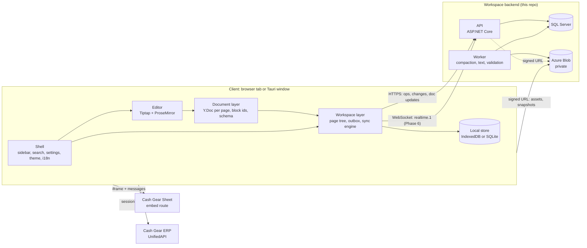
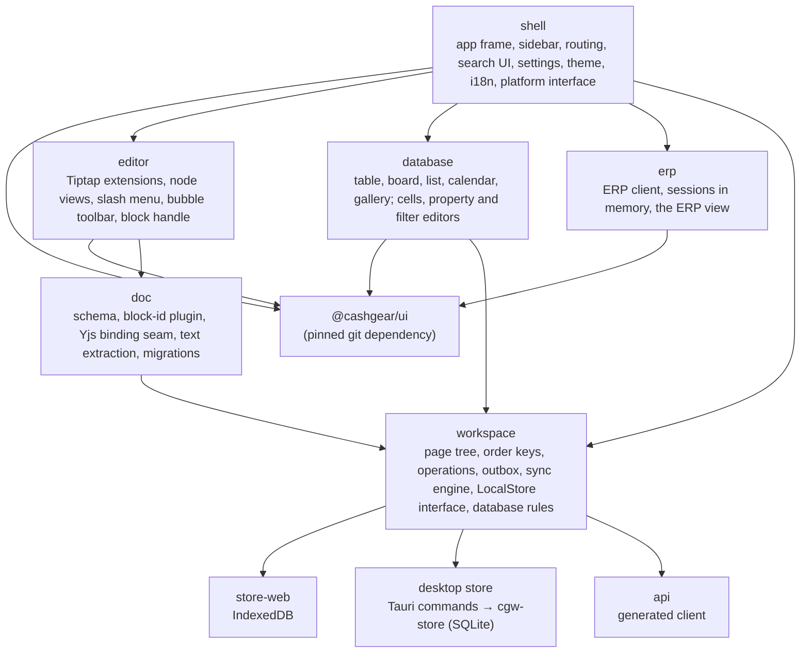
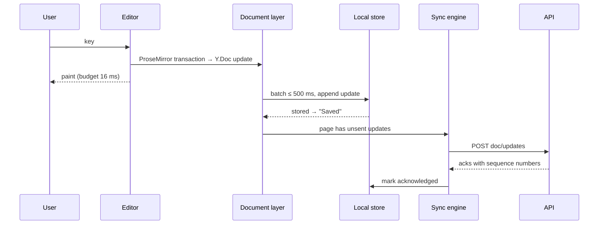

# Architecture

Cash Gear Workspace is a block-based workspace (documents, a page tree, databases, embedded
sheets and ERP data) that runs in a browser and as a Tauri desktop app, with a cloud backend and
offline editing.

This document says what the parts are and how data moves between them. Why each choice was made
is in `DECISIONS.md`. The stored shapes are in `DATA_MODEL.md`, sync in `SYNC_DESIGN.md`, and the
Sheet and ERP contracts in `INTEGRATIONS.md`.

Status: Phases 0 to 6 are built: the local-first editor and page tree (Phase 1); the server,
accounts, sync while online, sharing, server search and history (Phase 2); offline, conflicts,
migrations and the Mac app (Phase 3); workspace databases and their views (Phase 4); Sheet
workbooks embedded in pages and read-only ERP blocks (Phase 5); real-time editing over the hub,
presence, comments, mentions and the inbox, on one node (Phase 6). What exists
is listed in `CLAUDE.md`; later phases' parts are proposals. Spike results are in `DECISIONS.md`
(2026-11-11: Phase 0 results); each phase's answers and defaults under its own date. Deployment is
in `OPERATIONS.md`.

## What already exists in the Cash Gear ecosystem

Read from the repositories on 2026-11-11.

### Cash Gear Sheet (`D:\CashGear\Projects\cashgear-sheet`, v1.8.0)

| Area | What is there | Use for Workspace |
| --- | --- | --- |
| Tooling | pnpm 12 workspace, Cargo workspace, React 19.3, TypeScript 6, Vite 8, Tauri ~2.12, Vitest, Playwright, ESLint 10, Prettier 3 | Copy the root configs as the template |
| Licence gates | `deny.toml`, `license-policy.json`, `scripts/check-licenses.mjs` | Copy; same policy (no GPL, AGPL, LGPL, SSPL, BUSL) |
| CI and release | `.github/workflows/ci.yml`, `release.yml`, Azure Static Web Apps deploy, signed NSIS, updater feed on GitHub releases | Copy and rename |
| Tauri shell | `apps/desktop/src-tauri`: strict CSP, updater and dialog plugins, NSIS hooks, minimal capabilities | Copy the skeleton; Workspace's CSP differs (no COEP, `frame-src` for Sheet) |
| Platform split | `SheetPlatform` in `packages/ui/src/platform.ts`, implemented by `apps/web/src/platform/web.ts` and `desktop.ts`, chosen with `isTauri()` | Copy the pattern as `WorkspacePlatform` |
| Theme | `ThemeController` in `packages/ui/src/theme.ts`: system or manual, `data-cg-theme`, window title-bar theme | Copy and trim (no canvas palette) |
| Shortcuts | `packages/ui/src/shortcuts.ts`: Ctrl chords through `event.code`, so they work on an Arabic layout | Copy the mapping approach |
| Worker client | `packages/engine-client/src/client.ts`: Comlink, calls reject once disposed | Copy the pattern for the search and export workers |
| Updater UI | `release/useUpdates.ts`, `ReleaseDialogs.tsx`, `src/updates.rs` | Copy |
| ERP session | `packages/erp-connector`: HTTP client, session, launch ticket, validation of every response | Model for the ERP connector |
| Docs and workflow | `CLAUDE.md`, `docs/PLAN.md`, `docs/PROGRESS.md`, `docs/decisions.md`, phase tags | Same workflow here |
| Formula engine | Formualizer fork, MIT/Apache, behind `crates/cgs-calc` | Candidate for database formulas (Phase 4) |

Not there, so not assumed: an embeddable grid or app component; any iframe, `postMessage` or
embed mode; a read-only or preview mode; a range-to-image API; cloud workbook storage or
identity; user login; autosave (it has a crash-recovery journal instead); an i18n library or an
Arabic UI catalogue; a generic command registry. `AppShell.tsx` is one 3,140-line component.

### Shared UI (`D:\CashGear\Projects\CashGear.React.UI`, `@cashgear/ui` 0.1.0)

- The only React UI library. (`D:\CashGear\Projects\CashGearUI` is a legacy WinForms solution.)
- React 19 peer, no runtime dependencies, CSS Modules, `--cg-*` tokens, `data-cg-theme` for light
  and dark, `data-cg-density`, logical CSS, direction from the nearest `dir`, per-component
  `labels` props for translation, Storybook with Axe.
- Consumed as a git dependency pinned to a commit. Three apps pin three different commits.

| Workspace needs | In the library | Gap (Track U) |
| --- | --- | --- |
| Sidebar tree | `CgTreeView` | Drag-and-drop, lazy loading, virtualisation, inline rename |
| Resizable sidebar | `CgSplitter`, `CgDrawer` | None |
| Menus | `CgMenu`, `CgContextMenu` | None |
| Popovers | `CgFlyout` (anchors to a point or rectangle, flips, RTL-aware) | None; it is the base for the bubble toolbar |
| Slash menu, command palette | `CgListBox`, `CgSearchBox` | A command menu: filtered list, groups, keyboard, anchored to the caret |
| Bubble toolbar | `CgToolbar`, `CgButtonGroup` | A selection-anchored toolbar |
| Block handle, block drag | none | A drag handle and drop indicator |
| Dialogs, toasts | `CgPopup`, `CgMessageBox`, `CgToast`, confirmation provider | None |
| Tabs | `CgTabs` | None |
| Database table view | `CgGrid` | To be assessed in Phase 4 |
| Colours, icons | `CgColorPicker`, `CgIcon` (122 Fluent icons, mostly office) | Block-type and page icons; an emoji picker |
| Breadcrumb, avatar | none | Both |
| Rich text | `CgRichTextEditor` (Tiptap 3.31, sanitised HTML in and out) | Not usable as the block editor; confirms Tiptap is an accepted dependency |
| Ribbon | `CgRibbon` | Not used |

### Cash Gear ERP (`D:\CashGear\Projects\CashGear`)

- .NET 10, EF Core 10 and Dapper, SQL Server only. A database per tenant group plus a `Company`
  column in nearly every key. No EF migrations; schema changes are hand-run scripts. No local
  database.
- UnifiedAPI authenticates with long-lived API keys. For Sheet it has a ticket → session scheme
  with per-entity `Schema`, `Query` and `Commit` (see `INTEGRATIONS.md`).
- Azure Blob Storage is used through a connection string or account key. No signed URLs are
  generated anywhere. One container is public on purpose.
- UnifiedAPI has no rate limiting and an open CORS policy outside the Sheet routes. SignalR hub
  classes exist but none is mapped.
- Not inspected: production hosting, the live workflow configuration (it exists only in the
  database), and whether secrets in settings files are real.

What Workspace reuses from the ERP is the launch-ticket session pattern and its connector
contract. It does not share the ERP's identity store, database or deployment.

## Architecture options compared

| Option | Sketch | Verdict |
| --- | --- | --- |
| A. Local-first, CRDT documents, relational metadata, ASP.NET Core backend | Tiptap + Yjs in the client; SQL Server and Blob on the server; TypeScript sync engine over a local store | **Chosen** |
| B. Server-authoritative JSON documents | ProseMirror JSON saved by HTTP; the server is the truth | Simplest now. Offline on two devices can only be whole-page last-writer-wins, and real-time later means migrating every document and rewriting undo and sync |
| C. Everything in CRDTs, including the tree and databases | One sync mechanism | A CRDT cannot enforce "no cycles", permissions or uniqueness; moves in Yjs are delete and insert; server-side filtering of database rows would need to decode documents |
| D. Rust core compiled to WASM for the document model, as Sheet does for cells | One engine, native and web | Sheet draws to a canvas, so the engine can own the data. A rich-text editor is bound to the DOM, the IME and the selection; a WASM hop per keystroke costs, and every mature editor is TypeScript |
| E. Node collaboration server (Hocuspocus) | Ready-made Yjs server | Adds a Node service to a .NET estate that has none |

## System overview



Solid arrows inside the client are calls; the editor never talks to the network or to storage.

## The client

### Layers



Dependency rules, enforced by lint:

- `doc` and `workspace` import no React and no DOM. They run in a worker and in Node tests.
- `workspace` knows nothing about ProseMirror or Tiptap. It stores and moves opaque Yjs bytes.
  This is what keeps the page hierarchy independent of the editor.
- `editor` knows nothing about storage or the network. It is given a `Y.Doc` and callbacks.
- `database` (Phase 4) knows nothing about storage or the network either: it is given a
  `DatabaseHost` (records, a live row source per view, operations, people, assets), which the shell
  implements over the session, the local store and the sync engine. The editor knows nothing about
  databases: a `databaseView` block is a frame the shell mounts the views into
  (`EditorHost.databases`).
- `erp` (Phase 5) holds the ERP's answers in memory and React state only: lint keeps it off
  `localStorage`, `sessionStorage`, `indexedDB`, `caches`, the stores, `@cgw/workspace`,
  `@cgw/api` and the layers above it; it calls the ERP itself (`fetch`), with the reader's own
  session. The editor knows nothing about Sheet or the ERP: `sheetEmbed` and `erpView` blocks are
  frames the shell draws into (`EditorHost.workbooks`, `EditorHost.erp`); the sheet embed's
  contract and its iframe host (`SheetEmbed`, DOM and `postMessage` only) are in `@cgw/editor`.
- Only `shell` knows which platform it runs on, through the platform interface.

### Proposed repository layout

Package level only. Files inside are decided by the phase that creates them.

| Path | What | Phase |
| --- | --- | --- |
| `apps/web` | Vite + React app and PWA; picks the platform | 0 |
| `apps/desktop` | Tauri 2 shell | 0 |
| `packages/doc` (`@cgw/doc`) | Document schema, block ids, Yjs seam, migrations, text extraction | 1 |
| `packages/editor` (`@cgw/editor`) | The block editor | 1 |
| `packages/workspace` (`@cgw/workspace`) | Tree, operations, outbox, sync engine, `LocalStore` | 1 |
| `packages/store-web` (`@cgw/store-web`) | `LocalStore` on IndexedDB; from Phase 8 the device's own writes strict and its document updates journalled in the Origin Private File System (`journal/`, a worker; SYNC_DESIGN.md, Local durability) | 1 |
| `packages/shell` (`@cgw/shell`) | App frame and everything around the editor | 1 |
| `packages/api` (`@cgw/api`) | Client generated from the server's OpenAPI document | 2 |
| `packages/database` (`@cgw/database`) | Database views and cell editors, given a `DatabaseHost`; from Phase 8 cell selection, copy and paste in the table, board columns and gallery cards in an order of their own; from Phase 9 the timeline over the library's `CgTimeline`, and a calendar and a timeline reading their own rows by a date window (`ownRows`); from Phase 12 the chart view, with the chart's arithmetic, drawing, settings and words, which the chart block draws by, and the table for a screen reader | 4 |
| `packages/erp` (`@cgw/erp`) | ERP connector client and the ERP view; from Phase 12 report connectors and their block | 5 (built) |
| `crates/cgw-store` | `LocalStore` on SQLite, with FTS5 | 1 |
| `crates/cgw-native` | Desktop helpers without Tauri: deep links read into routes, safe file names; the keychain in Phase 2 | 1 |
| `crates/cgw-ydoc` | Bytes-in, bytes-out Yjs functions over `yrs` | 0 (spike), 2 |
| `server/` | .NET solution: API, worker, domain, infrastructure, tests | 2 |
| `tests/e2e`, `tests/mocks` (Phase 5: Sheet and the ERP), `tests/contracts` (Phase 5: `erp-connect.1`), `bench/`, `scripts/`, `docs/` | As in Sheet | 0 |

### Responsibilities

| Component | Owns | Does not |
| --- | --- | --- |
| Shell | Window layout, sidebar, breadcrumbs, routing, search box and results, settings, profile, workspace switcher, theme, language, connection status | Touch document content |
| Editor | Typing, selection, formatting, slash menu, Markdown shortcuts, drag and drop, clipboard, node views, keyboard navigation | Save, load, or call the network |
| Document layer | The schema; block ids; binding ProseMirror to a `Y.Doc`; undo; plain-text and Markdown output; schema-version check and migrations | Know where bytes are stored |
| Workspace layer | The page tree and its rules on the client; operations and the outbox; the sync loop; opening and closing documents; asset upload queue | Know what is inside a document |
| Local store | Durable local data behind `LocalStore` | Decide anything |
| Platform | What differs between browser and desktop: window theme, file dialogs, deep links, updater, keychain, which `LocalStore` | Hold app logic |

### Platform interface

Modelled on `SheetPlatform`, with different members:

```ts
interface WorkspacePlatform {
  kind: 'web' | 'desktop';
  apiBase?: string;                         // the Workspace API's origin (Q5); absent: this device only
  auth?: AuthPlatform;                      // the API's cookie, or PKCE with the keychain (below)
  webBase?: string;                         // the web app's, for share links made on the desktop
  openStore(): Promise<LocalStore>;
  setWindowTheme(theme: Theme | null): Promise<void>;
  saveFile(suggestedName: string, bytes: Uint8Array, type: string): Promise<void>;   // export
  openExternal(url: string): Promise<void>;
  requestPersistence?(): Promise<boolean>;  // browser
  onDeepLink?(open: (hash: string) => void): () => void;                            // desktop
  updates?: PlatformUpdates;                                                         // desktop
  onCloseRequested?(flush: () => Promise<void>): () => void;
  print?(job: PrintJob): Promise<'printed' | 'saved' | 'cancelled' | 'dialog'>;    // Phase 19, desktop
  printMode?: 'css' | 'paged';                                                       // Phase 19
}

type AuthPlatform =
  | { kind: 'cookie' }                      // the browser: nothing here holds a credential
  | { kind: 'bearer'; signIn(language): Promise<boolean>; token(): Promise<string | null>; signOut(): Promise<void> };
```

As built (`packages/shell/src/platform.ts`). The shell's `cloud/` folder holds the connection to
the API: the typed client (`@cgw/api`) authenticated by the platform's `auth`, the sync engine
(`@cgw/workspace`) wired to the open session, and the account, sharing and history screens.

### The editor

- **Engine.** Tiptap 3 on ProseMirror, with `prosemirror-tables` for tables.
- **Schema.** A uniform block container (`DATA_MODEL.md`). Lists are blocks.
- **Node views.** Plain DOM for every MVP block: text bodies, code blocks, images, files,
  bookmarks, child pages and tables (Phase 1: each is small, and the editor needs no React
  renderer). The menus, toolbars and table controls drawn over the editor are React. Embeds
  (Phases 4 and 5) may use React node views; heavy ones mount when scrolled near and unmount when
  far. As built in Phase 4, the database block is a plain DOM frame: it mounts the host's React
  view within 800 px of the scrolling pane, unmounts it beyond 2,400 px, and mounts again only when
  its database, view, block id or editability changes, never per transaction. Phase 5 put the
  database, sheet embed and ERP view blocks on one such lazy frame (`nodeviews/frame.ts`): mounted
  again only when the key changes (database, workbook or link; block id; editability), and given
  other attribute changes in place.
- **Slash menu.** Typing `/` opens a command menu at the caret, filtered as the user types, in
  the interface language, with keywords in both languages.
- **Markdown shortcuts.** Input rules: `#`, `##`, `###`, `-`, `1.`, `[]`, `>`, ```` ``` ````, `---`,
  `**bold**`, `*italic*`, `` `code` ``, `~~strike~~`.
- **Bubble toolbar.** On a text selection: bold, italic, underline, strike, code, link, colour,
  turn into. On a block selection: turn into, duplicate, delete, colour.
- **Block handle.** Appears beside the hovered or focused block: drag to move, click for the
  block menu. Reachable by keyboard.
- **Conversion.** "Turn into" changes the body kind and keeps the id, the text, the marks that
  are valid in the target, and the children.
- **Clipboard.** Copy writes our own format (with fresh-id marking), HTML and plain text. Paste
  prefers our format, then HTML through the schema's parser, then Markdown, then plain text.
  Pasted blocks always get new ids. Whole blocks (blocks copied, Markdown, HTML that starts with a
  picture) go beside the block holding the caret, never inside it, placed as Enter splits it: in
  an empty block's place, above a block from its start, else after the head with the text after
  the caret in a block of its own; each pasted line of text is a block of its own.
- **Undo.** Yjs `UndoManager`, tracking only the local user's changes.
- **Keyboard.** Everything reachable without a mouse: arrows across blocks, Tab and Shift+Tab to
  indent, Alt+Shift+arrows to move a block, Esc to select the block, Ctrl+/ for the block menu.
  Ctrl chords map through `event.code`, as Sheet does, so they work on an Arabic layout.

### Commands

One small command registry in the shell: `{ id, label, icon, shortcut, when, run }`. The slash
menu, the bubble toolbar, the block menu, the search palette (Ctrl+K) and keyboard shortcuts all
read it. This is new; Sheet has typed engine commands but no generic registry to reuse.

### Search

| Where | Index | Covers |
| --- | --- | --- |
| Browser | In memory, built in a worker from the local mirror and cached page text | Titles of every page; text of pages this device holds |
| Desktop | FTS5 in the local SQLite store | The same, durable |
| Server (Phase 2) | SQL Server full-text over `PageDocDerived.SearchText` and titles | Everything the caller may read |
| Server, by meaning (Phase 10) | Voyage AI's int8 vectors of each page's title and derived text in chunks (`PageEmbeddings`), scored exactly in the API process from an in-memory copy per workspace; from Phase 13 a row's property values too, past 200,000 chunks the nearest by sign bits scored exactly (the approximate index), and the vectors of `voyage-4-nano` on the server itself when a workspace chooses it | Pages the caller may read, with search by meaning on; never a vector to a client |

Online, results from the server and the local index are merged, local first. From Phase 10, with search by meaning on, the palette also asks the server's meaning search once the person pauses and lists the pages the words did not find under "Related by meaning". Text is normalised
the same way everywhere before indexing and querying (D25). Results are filtered by permission on
the server at query time, never by the client.

### Cells in bulk (Phase 8)

The table selects cells (an anchor and the active cell, in its own state, so the selection outlives
the virtual window's scrolling), copies them as tab-separated text and an HTML table (the values
as shown; the tab keeps the copied values in memory for a paste of the same text), and pastes and
clears them through `clipboard/paste.ts`: each pasted text read by a paste-only reading of what
Excel and Sheet show in the device's language (`clipboard/read.ts`), then by the conversion table,
planned, then written as one batch through `DatabaseHost.apply`. The table's own notice offers
Undo, which writes the old values back. Board columns keep an order per view (`group.order`);
gallery cards move by the rows' order keys.

### Import (Phase 8)

`packages/shell/src/exchange/import` reads a Markdown folder or zip, a Notion export or a Word
`.docx` on the device; the server never opens an archive. Everything is planned in a worker: an
archive is listed by its central directory and refused before anything unpacks when it declares
more than 500 MB, more than 20,000 files, or an entry that unpacks to over 1,000 times its size;
entries with `..`, absolute paths or control characters are left out; archives of archives
(Notion's parts) are read two deep. Markdown goes through `@cgw/doc`'s Markdown in with the
import's resolvers, Word through `@cgw/doc`'s own XML reader (no DOMParser in a worker, no DTD).
The plan (operations, documents, assets) comes back to the main thread, which writes it through
the session in order: assets (the engine uploads them), operations 500 at a time, then each page's
first document with the session's client id. Everything goes under one new page; on a failure or
a Stop that page is trashed and deleted for good in one batch, and its search entries removed.

### The chart view (Phase 12)

The seventh view type (`packages/database/src/views/chart/`): a view's own groups as bars, a line or
a pie, by a count, a sum or an average (DATA_MODEL.md, Databases). The chart block's arithmetic
(`aggregate.ts`), drawing (`ChartCanvas.tsx`, the only module that imports `CgChart`, loaded by
`lazy()` from `drawing.tsx` with the first chart drawn, so `CgChart` is a chunk of its own),
settings controls (`ChartControls.tsx`), config reading (`config.ts`) and words moved here from
`@cgw/plugins`, and the block draws by them. A count is `DatabaseView`'s own query's group counts at
any size; a sum or an average opens a query of its own, 500 rows a page, group by group up to 5,000.
The view type says its own failures (`ownErrors`): `DatabaseView` shows no notice above it, and a
share link's `chart.hidden` is said once, in the chart's words. A share link draws it over the
link's read-only host as the app does, the server grouping its rows; a site draws it on the server
by the chart block's routine (`SiteDatabaseHtml`: SVG and its numbers as a table).

### The grid with a screen reader (Phase 12)

The table (`table/TableView.tsx`, `TableRow.tsx`, `TableHeader.tsx`, and `items.ts`'s pure
`ariaLayout`) is a `grid` named "<database>: table" and described by its foot ("Rows: 300",
"Rows: 100 of 5200"). Its `aria-rowcount` is the header and the query's total (`RowSnapshot.total`,
the server's for a database it answers), and each row's `aria-rowindex` its place of that total as
the virtual window scrolls (rows kept in ascending DOM order). The title cell is the row's
`rowheader`, named by its text; every other cell a `gridcell`; a column header is named by its
property and described by its type. "Load more" is a row at the index of the first row not loaded;
the "New" line is no row (`aria-hidden`), reached by the keys and said by the live region. A grouped
table is a `treegrid`: each group a row at level 1 (expanded or not, its place among the groups,
named by its group and count, itself the active descendant; Left collapses and Right expands it,
mirrored in Arabic), its rows at level 2 with their place in the group of its count
(`aria-posinset`, `aria-setsize`). Chromium numbers every row of a grid, so a grouped table's
indices count the groups' headers too (DECISIONS.md, Phase 12). Editing is said through the table's
`CgLiveAnnouncer` when it starts, is saved and is cancelled, naming the property and the row. CI
checks what Chromium computes (`tests/e2e/grid-a11y.spec.ts`); the readers are checked by hand
(`docs/SCREEN_READERS.md`).

### Report blocks (Phase 12)

An ERP block may show a report connector (INTEGRATIONS.md, Reports). `ErpView`'s picker lists
"Lists" and "Reports" (`Connectors?kinds=entity,report`); a report's parameters
(`view/ReportParameters.tsx`: a date, a choice or a lookup, a switch; read-only for a reader who may
not edit the page) sit above a read-only table (`RecordsTable.tsx`) that ends with a totals row,
takes the answer's labels, and says when the report is partial or stops at `maxRecords`. The
parameters are the block's `parameters` attribute (DATA_MODEL.md); the answer is held in memory
only, as every ERP answer. It is asked for when drawn, on Refresh and on a parameter's change;
never edited, never given to AI.

### Words that come with their screens (Phases 11 and 12)

The initial JavaScript (350 kB, gated) holds the shell's catalogues, which merge the database
views', the ERP's and the plugins' catalogues at start. A new screen's words come with it instead:
sections of the shell's catalogue added when their screen first draws (`i18n/sections.ts`; Phase
11's groups, passkeys and single sign-on, Phase 12's `offlineRows` for Settings → Offline's row
documents), and catalogues a lazily loaded package merges into the app's instance with
`addResourceBundle` when it first draws (Phase 12: `database.chart`, `views/chart/words.ts`, with
the first chart; `database.grid`, `table/words.ts`, the table's announcements, with the first table;
the ERP's report words under `erp`, `packages/erp/src/i18n/reports.ts`, with the first ERP block).

### Automations in the client (Phase 15)

A database's rules are edited in its views (`packages/database/src/automations/`): the toolbar's
Automations opens a dialog of its rules (each with its switch, its trigger and its last run), the
rule editor (the trigger, the rows it is for in the views' own filter editor, steps in order in
`CgSortableList`, each checked by `checkAutomation` before it is saved), a rule's run log and a row's
runs under its properties. The views know rules only through `DatabaseHost.automations`, which the
shell gives a synced workspace (`packages/shell/src/automations/host.ts`, `ShellAutomations`: saves
through the outbox, reads and presses over the server's routes, the server's `/version` for the
button); a local workspace has none, and the toolbar shows nothing. The rules' code is
`@cgw/workspace/automations`, an entry of its own: the rule editor imports it when it loads, so the
initial JavaScript holds none of it (349.5 kB of 350 at 0.15.0, with the library's flyout, menu and
drag code kept in one chunk, `ui-overlay`, which the new screens had split). The screens' words come
with them (`automations` in `@cgw/database`'s lazily merged catalogue, the shell's `automations`
section for Settings → Automations and a press's notices). The button property's cell presses once
for an editor, never offline.

### Forms in the client (Phase 16)

The form view (`packages/database/src/views/form/`) is the eighth view type: it reads no rows, so the
toolbar shows no filter, sort, search or New for it (`supports.rows: false`). Who can edit the
database answers it (`FormAnswer`: a page at a time, each checked by `checkAnswers` and the next shown
by the conditions, the answer one `page.create` with `formId` through the outbox, offline too) and
edits its questions (`FormBuilder`: each change the view's `view.upsert`, its `properties` following
the questions); a reader is drawn the form and sends nothing. "Share form" (`FormShare`) reads and
changes the link through `DatabaseHost.forms`, the shell's `ShellForms` over the server's routes
(`packages/shell/src/forms/host.ts`, loaded with the cloud), which also reads `/version`: "Add a view"
offers a form only once the server keeps one (`DatabaseHost.viewTypeKnown`), and the Contacts
template leaves its contact form out otherwise. The rules are `@cgw/workspace/forms`, an entry of its
own, and the words (`database.form`) are merged with the first form drawn (`ft`), so the initial
JavaScript holds none of them (349.7 kB of 350 at 0.16.0).

### Workflows and tasks in the client (Phase 17)

The rule editor gains waits, branches and approvals (`StepList`: a step's own list of steps inside a
branch's paths and an approval's three, to the third level), a repeating row (`Series.tsx`: a
template, a first day, the library's `CgRecurrenceFields` in the automations' words, by its days or
by the last done) and a notice's "Send it as a reminder"; the inbox answers an approval
(`ApprovalAnswer`) and shows a reminder. "Repeat a template" in the New menu and a date property's
"Remind people of this date" open the editor on a new rule (`openAutomations` with a name and
steps). A row's page has "Remind me" (`RowReminders`), a choice for each date property, read and set
online over `AutomationsHost.reminders`. Every one of these is offered only once the server's
`/version` counts 7 step kinds (`AutomationsHost.knowsWorkflows`; the shell's `ShellAutomations`
reads it). A table nests sub-items (`table/items.ts`'s tree, a tree grid by levels, places and
sizes), a board's card and a list's line count them, and a timeline draws dependencies (Track U20's
`links`) and moves a blocker's dependents with it; a unique id is a cell read from the row's
`number`. Their words come with them (`database.automations`, `database.tasks`, merged with the
first of them drawn); the desktop's SQLite store is imported when the desktop opens it, so the web
app's initial JavaScript holds none of it (348.6 kB of 350 at 0.17.0).

### Word, PDF and print (Phase 19)

A page, or a row, leaves as a Word file, a print or a PDF, made on the device from what it holds,
offline too: nothing goes anywhere but to the file the person saves or the printer.

- **What is read.** `packages/shell/src/print/collect.ts` reads the page's content from its
  document, its sub-pages when asked (at most 200, in the tree's order), the pictures they hold from
  the store, a database block's view through `@cgw/database/out` (`viewOut`: the view's rows as a
  table, at most 1,000 and then "Rows not shown: n"; a chart view as its chart, drawn off screen by
  `ChartCanvas` in the light theme and read as SVG; a form view named), a row's properties
  (`rowProperties`), a sheet block's kept picture and a plugin block's line. An ERP block is a
  placeholder naming its connector ("Cash Gear ERP: vendors (its data is not exported)"): nothing of
  the ERP is read. The result is `@cgw/doc/out`'s `OutInput`, plain data with its words translated.
- **Where it is read (after 0.19.0).** A page's content never comes to the main thread: the shell
  reads each page's stored log from the store (an open page writes what it holds first) and posts it
  to the page out's worker (`print/out.worker.ts`; one page out at a time, kept a minute for the
  next). There `assemble.ts` replays it (`@cgw/doc/out`'s `readContent`: what opening the page to
  read does, a bad update named for the store's quarantine), turns it to JSON and walks it for what
  only the main thread can resolve: the files its pictures show, the pages and people it names, its
  blocks that are not text. The main thread resolves those (the store's bytes, the mirror's titles,
  `viewOut`, whose rows become text in slices of 4 ms, the sheets' pictures, the plugins' lines) and
  sends them back, and the worker puts each page's content back into the input and makes the file or
  the view. Until then the replay of a page of 2,000 blocks, its JSON and the walk held the main
  thread for about 80 ms at once, and the input's copy to the worker for 12 ms more.
- **Word.** `writeDocx` (`packages/doc/src/out/docx.ts`) writes WordprocessingML's parts by hand,
  pure: styles (never bold by a heading's style alone), numbering, a table of contents as a field,
  the layout's header and footer, check boxes, pictures and tables. The page out's worker zips them
  with fflate. It is held to Phase 8's reader by a round trip (`docx.test.ts`) and to OOXML by
  DocumentFormat.OpenXml's validator over `packages/doc/vectors/docx-vectors.json` in the server's
  tests (`DocxVectorTests`).
- **Print.** `printView` (`packages/doc/src/out/print.ts`) draws the same input as HTML and CSS of
  its own, never the editor's DOM (after 0.19.0 in the page out's worker). The shell mounts it in
  the app's own document (`.cgw-print-root`; under print media everything else is hidden) and prints
  with `window.print()`. In Chromium (Chrome, Edge, WebView2) the mode is `css`: the paper, margins,
  header and footer by `@page`, a named page and its margin boxes (sides swapped in Arabic). WebKit
  (Safari, WKWebView) draws no margin boxes, so the mode is `paged`: `print/paginate.ts` measures the
  content and cuts it into boxes of a page each, the bands drawn in every one.
- **Save as PDF.** On the web the browser's dialog and its "Save as PDF", which the app says first.
  On the desktop `platform.print(job)` (`print_page`, `apps/desktop/src-tauri/src/print.rs`): on
  Windows WebView2's `PrintToPdf` writes the file the person chose, with the job's paper and
  margins and no header of WebView2's own, and Print is `window.print()`; on macOS an
  `NSPrintOperation` over the WKWebView, its print info from the job, saves to the file chosen
  without a panel, or shows the print panel for Print.
- **Page setup.** `print/PageSetup.tsx` edits the page's `layout` (DATA_MODEL.md, "A page's
  layout") with a preview of a page. The page's menu and a row's have Page setup…, Export to Word,
  Print… and Save as PDF…. All of it loads when first used (`PrintDialogs`, lazily from
  `PageView`), its words a section (`print`), so the initial JavaScript holds none of it (349.6 kB of
  350 at 0.19.0).

## The backend

One ASP.NET Core (.NET 10) solution in `server/`. Three processes (the Sites process from Phase 9).

| Process | Does | Never |
| --- | --- | --- |
| API | Authentication, authorisation, operations, change feed, document push and pull (Phase 12: a batch pull of up to 100 pages, `Cgw.Core/Documents/DocPulls.cs`), asset tickets, search queries, sharing, version listing, the real-time hub (Phase 6: relays validated updates, presence, feed movement), comments and the inbox, the account's mail choice and the mail's unsubscribe link (Phase 8); Phase 18: AI's answers on the server's own model (the only process that loads it), the billing routes and Paddle's signed webhook | Loads a Yjs library, or decodes an update, a presence state or a relative position |
| Worker | Compaction, snapshots, validation of updates (on a loop of its own, every 25 ms when idle; from Phase 8 each state it checks loaded once), mentions found in derived pages (Phase 6), each page's state hash, derived JSON and text, backlinks, asset reference counting and clean-up, retention (the change feed after 90 days, the trash after 60), exports, notification mail (Phase 8: queued for each person with mentions or replies unread past the delay, made and sent on a loop of its own under a daily cap); Phase 15: the rules' runner (`automations`, a loop of its own every 100 ms) and webhooks' calls (`webhooks`, every second); Phase 17: runs that wait and repeating rows (in the rules' runner, every second) and people's reminders (`reminders`, a loop of its own every second); Phase 18: workspaces' plans read again from Paddle (`billingReconcile`, hourly, each not read for a day) and a workspace deleted for good stopped paying there before its purge | Serves requests; holds an ERP session or key |
| Sites (Phase 9) | Published pages as HTML on an origin of its own (`server/src/Cgw.Sites`, IIS site `CashGearWorkspaceSites`, `pages.cashgearerp.com`; `http://localhost:5290` in development), rendered on the server from the worker's derived JSON; `robots.txt`; a page's files by a redirect to a short signed URL checked on every request; from Phase 16 a form link's pages (`/_form/{token}`: drawn, a page's post checked and the next page drawn, the last page's post sent on to the API). From Phase 10 also the plugins origin, a second host name of the same site (`plugins.cashgearerp.com`; `http://localhost:5291` in development): a third-party plugin's bundle files under a frame ticket found by its hash, with a CSP of no network (Phase 13: a CSP per bundle, `connect-src` the hosts an owner or admin approved). From Phase 18 the pay page (`/_pay/en`, `/_pay/ar`): Paddle.js opening Paddle's checkout for a transaction the API made, given Paddle's client-side token only | Signs anyone in, sets or reads a cookie, sends script on the pages origin (but the pay page's own and Paddle.js, on its pages only, under a CSP naming Paddle), loads a Yjs library, Data Protection or the local model, writes anything |

Both processes share one Data Protection key ring (`DataProtectionKeys`): from Phase 8 the worker
writes the unsubscribe tokens the API reads.

Modules, each with its own folder, services and tests: Identity, Workspaces, Pages, Documents,
Assets, Search, Sharing, Sync, Audit, Databases (Phase 4), Workbooks and ErpLinks (Phase 5,
`Cgw.Core/Workbooks`), Realtime, Comments and Notifications (Phase 6: `Cgw.Api/Realtime`, `Cgw.Core/Comments`, `Cgw.Core/Notifications`), and Ai (Phase 7: `Cgw.Core/Ai`, the routes in `Cgw.Api/Modules/AiEndpoints.cs`; the only code that calls a model provider, through Anthropic's C# SDK with the workspace's own key, and with no route to the ERP; from Phase 10 also Voyage AI's embeddings over `HttpClient`, with a second key of the workspace's own). Phase 10 adds search by meaning (`Cgw.Core/Search/MeaningSearch.cs`: the API keeps each searched workspace's vectors in memory, capped, brought up to date from `EmbeddingChanges`; the worker's `embed` job is the only writer of vectors) and Plugins (`Cgw.Core/Plugins`: bundles read as hostile archives, stored as private blobs, frame tickets; the routes in `Cgw.Api/Modules/PluginEndpoints.cs`). Phase 13: a plugin's network (`Plugins/PluginHosts.cs`, the approved hosts in its row, the CSP per bundle) and plugins in the change feed; a row's property values in its chunks (`Ai/EmbeddingValues.cs`); the approximate index in `MeaningSearch.cs`'s `EmbeddingsCache` (sign bits beside each chunk, past `Ai__EmbeddingsApproximateFrom`); the local model, a project of its own (`server/src/Cgw.LocalModel`: ONNX Runtime, the Qwen tokenizer, `EmbeddingRouter` sending `voyage-4-nano` to it and every other model to Voyage), referenced by the API and the worker only, loaded on first use and unloaded when idle; and Cash Gear's subscription (`Ai/AiSubscription.cs`: its keys from the environment, each workspace's allowance reserved before a call in `AiReservations`). The Databases module (`Cgw.Core/Databases`) holds the C# port of the database rules
(coercion, conversion, queries, formulas, rollups, CSV) held to the TypeScript by shared vectors,
the operations on databases, views and rows, and the query engine: a database's rows cached in
memory per database and rows version, evaluated by the ported `queryRows`, keyset paged.

Phase 9's Sites (`Cgw.Core/Sites`): `PublishingService` (the site records, the workspace's switch,
the audit), `SiteReader` and `SiteCache` (what the Sites process reads and holds) and `SiteRenderer`
with its parts (a page as HTML). What a site shows is a share link's scope decided at read time
(`SharedReader`), its databases through their views (`Sharing/SharedDatabases.cs`, which a share
link reads too: the view's shown and layout properties' values only, never a person's; from Phase 12
a chart view's exactly its title, group and measure, `Sharing/ChartViews.cs`, drawn by the chart
block's routine or its placeholder), and its files by a checked redirect. The Sites process keeps a
slug's site and scope at most 30 s and drawn pages by a key of everything they are drawn from; every
answer is `no-cache` with a strong ETag and a strict CSP (`default-src 'none'`, one hashed
stylesheet, images from the site and the blob account). It reads SQL and Blob with the API's
configuration names.

Phase 14: a site at its workspace's own host name (`Cgw.Core/Sites/SiteDomains.cs`, routes under
`/workspaces/{id}/publishing/domains` and `/pages/{id}/site/domain`). The Sites process tells its own
host name (`Sites__PublicUrl`) and the plugins' from any other: any other is a site's own, found by
the name (`SiteReader.StateByHostAsync`: proven, attached, its certificate live) and drawn from `/`
(`SitePage.Base` empty, the renderer's links from it), with its own `robots.txt`, ACME's HTTP-01
answers, and `http` sent on to `https` in Production; the slug's addresses of such a site lead there
(302); an unknown name is the 404 page. On its own host it answers ACME's path by the token alone (the
IIS host's catch-all http site sends it there for a name not bound yet). Its rate limit
(`Cgw.Sites/SiteLimits.cs`) runs before all of it. The worker's `SiteCertificateJob` makes and renews
the certificates by ACME (`Cgw.Core/Sites/Acme.cs`, the server's own client) into a folder of PFX
files, which a scheduled task on the IIS host (`deploy/iis/site-bindings.ps1`, as SYSTEM) imports and
binds by name, as the host's other sites are bound; it reads each name's proof again, and takes a name
whose proof is lost off its site (INTEGRATIONS.md). Phase
11's DNS reader moved into the core for it (`Cgw.Core/Domains`, `IDomainDns`), for the API and the
worker alike. Phase 14 also indexes rows' files (`DatabaseRowFiles`, `Databases/RowFiles.cs`) for
members' reads, the clean-up and a site's file check, and writes `site` and `publishing` changes to
the feed.

Phase 15's Automations (`Cgw.Core/Automations`, the routes in `Cgw.Api/Modules/AutomationEndpoints.cs`,
the worker's `Jobs/AutomationJobs.cs` and `Jobs/WebhookJobs.cs`). A rule is checked by the C# port of
`db/automations.ts` (`AutomationRules`, held to it by `db-automation-vectors.json`) and saved as an
operation (`AutomationService`). What starts rules is written where rows are written:
`DatabaseOps.FlushAsync` adds an `AutomationEvents` row for every row it writes, in the same
transaction, while the database's `EventRules` count is above 0 (read from the record the flush
holds already, so a database without rules pays nothing), and a button's press adds one by its own
route. The worker's `AutomationJob` takes the events in order (one statement, `UPDLOCK, READPAST`,
so a second worker takes the next), the dates reached (each date rule's dates read by one property,
`JSON_VALUE`, and held while the database's rows and the rule do not change: `DateDueCache`) and the
schedules due (`NextAt`, worked out in the workspace's time zone by `AutomationTimes`); for each
matching rule it records a run (unique by its event or moment), checks its author can still edit,
the depth (3) and the limits (100 a minute a rule, 1,000 a workspace), then runs its conditions and
steps as the author through the operations' own path (`OpsService` in a child scope, with
`DatabaseOps.Origin` naming the run, so the events its changes write carry it). A row's new page
copies its template's body by `cgw-ydoc`'s `cgw_copy_body` in the worker (new block ids from a seed,
the update written as the page's first validated one), as the API loads no Yjs library. Notices are
the inbox's (`automation`); webhooks' calls are `WebhookDeliveries` the `WebhookJob` sends
(`WebhookSender`: POST only, no redirect, the address checked at connect by `SafeFetcher`'s rules,
signed; INTEGRATIONS.md). No step reaches the ERP: the runner holds no ERP session or key, and a
test reads its sources for any.

Phase 16's Forms (`Cgw.Core/Forms`, the routes in `Cgw.Api/Modules/FormEndpoints.cs`, the Sites
process's `Cgw.Sites/FormPages.cs`). A form is read and an answer checked by the C# port of
`db/forms.ts` (`FormRules`, held to it by `db-form-vectors.json`); a link's posted fields are read by
`FormPosts` (a date and time typed in the workspace's zone). A form link's pages are the Sites
process's, under `/_form/{token}` on its own host (no slug starts with `_`): HTML with no script and a
stylesheet of their own (`FormHtml`, `FormWords` in English and Arabic), a policy whose `form-action`
names only the Sites process and the API (`Api__PublicUrl`); a `GET` draws the first page shown (kept
by `SiteCache` by a key of the link's, the view's and the database's versions), a `POST` checks the
page and draws the next one with the earlier answers in hidden fields, or the same one with what is
wrong, and after the last a 307 sends the same post on to the API. It reads the link by its token's
hash (`FormLinkReader`) and writes nothing. The API's `POST /api/v1/forms/{token}` takes the answer with
no session (none is read, a cookie sent is ignored) and no antiforgery token: the address's own
windows first (`FormLimits`, in memory: 10 a minute and 100 a day a link, an IPv6 address by its
/64; past them 429 with `Retry-After` and a fixed page), then the anonymous window; the link and its
form read again, the trap field (`website`), the rules' check; then, in the workspace's lock, one
statement that counts the answer only while the link is on, open and under its maximum, the row made
with no member through `DatabaseOps.CreateAnsweredRowAsync` (its events' `FormId`, so "a form is
answered" runs), the audit with the address; a 303 to the thank-you page, or to the form's page,
which says why. The members' routes (`FormService`) read a form's count and link and make, change
and delete the link with full access; the token is kept as its hash and under Data Protection.

Phase 17's workflows and tasks (the same Automations module and worker job; `Recurrence`,
`RecurringSeries`, `Approvals`, `Reminders` in `Cgw.Core/Automations`; `Databases/Dependencies.cs`,
`Databases/UniqueIds.cs`; the worker's `Jobs/ReminderJobs.cs`). A run that waits is a row of
`AutomationRuns` (`waiting`, its place, until when, the definition it started with); it holds no
lock, and the job takes those due every second by one statement (`UPDLOCK, READPAST`), a row's change
waking those that wait on it and an approval's deciding answer its run. A branch is a path the run
takes by the row as it is then; an approval's people are asked in the inbox and by mail
(`AutomationApprovals`), answered by their own route. A repeating row is a rule whose trigger makes
its row: the job's series pass (every second) takes the rules whose next day has come, makes the row
from the template as the author by the same `addRow` path, its run's key the day, then moves the
series on (`RecurringSeries`, by `Recurrence`, the C# port held to `db/recurrence.ts` by its
vectors); a series by the last done is moved by its last row's change, read from the events. People's
own reminders are `RowReminders`, their moments kept with them and worked out again by
`DatabaseOps.FlushAsync` when a row's date changes (only while its database's `Reminders` counts
any) and by `ReminderJob` every 10 minutes; `ReminderJob` sends those due, a thousand at a time,
each checked against the person's access to the row. A query nests rows by a relation to the
database itself (`Query.Nest`, from the cache, paged by the last row's id); a row's write that would
make it blocked by a row it blocks is refused (`Dependencies`, after the relation's edits). A row's
number is given in its insert's transaction from `Databases.NextNumber` (`UniqueIds`).

Phase 18, AI further. **Completions on the server's own model**: `Cgw.LocalModel`'s
`LocalCompletionProvider`, a second `IAiProvider` beside Anthropic's, `AiProviderRouter` sending a
call of the server's model (`qwen3.5-4b`) to it and every other to Anthropic; ONNX Runtime GenAI
0.20.0 over the same ONNX Runtime (1.32.0) as the embedding model, in the API process only (the
worker references the project for embeddings and never registers it; the Sites process loads no
runtime). The request is still `AiRequestBuilder`'s, held to the local model's own limits
(`AiLimits.Local`); one answer is written at a time a process on a thread of its own, the rest in
line in order (`AiQueued` to a client that asks), a JSON action held to its schema by GenAI's
guidance. **Billing**: `Cgw.Core/Billing` (Paddle's API over `HttpClient`, its webhook's signature,
`BillingService`), the routes in `Cgw.Api/Modules/BillingEndpoints.cs` (Paddle's webhook with no
session or antiforgery, taken only signed), the pay page on the Sites process (`PayPages.cs`: Paddle.js
on an origin with no cookie or session), and the worker's hourly `billingReconcile`. A plan is read
from Paddle's API and applied in one place, its price on the AI settings row under the lock every
reservation takes, so Phase 13's allowance reads it with no query of its own.

Conventions:

- **API style.** REST under `/api/v1`. JSON in camelCase. Resource routes, not verbs.
- **Contracts.** The OpenAPI document is generated from the code and checked into the repo. The
  TypeScript client is generated from it. A change to it shows in review.
- **Errors.** RFC 9457 ProblemDetails with a stable `code` (for example `tree.cycle`,
  `doc.epochMismatch`, `version.conflict`) and a `correlationId`. Clients switch on `code`, never
  on text.
- **Concurrency.** `ETag` and `If-Match` on single-record writes; `baseVersion` in operations.
- **Paging.** Keyset, with an opaque cursor.
- **Results.** Services return a result type, not exceptions, for expected failures.
- **Data access.** EF Core with migrations. A global query filter applies the workspace scope;
  raw SQL is allowed only in named, tested queries (search, the closure table) and, from Phase 8,
  the push's path: the hub push's gate and transaction, the relay's heads and frames, the
  validation pass's reads and writes, where EF's work per statement was most of a push.
- **Tests.** Each module is tested against a real SQL Server in a container, not an in-memory
  provider.

### Tenancy

- The workspace is the tenant. Every tenant-owned row has `WorkspaceId`.
- A request's workspace comes from the route, and the caller's membership is checked before any
  handler runs. The EF Core filter then scopes every query.
- A test walks every entity type and fails if one with `WorkspaceId` lacks the filter.
- Blob names start with the workspace id, and a signed URL covers exactly one blob.

### Authentication

| Client | Flow | Credential at rest |
| --- | --- | --- |
| Web app | Sign in on the API's own pages; `Secure`, `HttpOnly`, `SameSite=Lax` cookie; antiforgery token on writes | Cookie only. Nothing in `localStorage` |
| Desktop app | Authorisation code with PKCE through the system browser, back to a loopback listener on a port the app picks (RFC 8252, 7.3). The API's page asks the signed-in person to confirm the desktop's sign-in ("as {email}?") and issues the code only on that form's POST, so a link cannot sign a desktop in silently. The native side (`crates/cgw-native`, `apps/desktop/src-tauri/src/auth.rs`) exchanges and refreshes the tokens; the API bases it may talk to are fixed at build time | Refresh token in the OS keychain (Windows Credential Manager; the login keychain on macOS), never in the webview; access token in memory |
| Sheet (opening a workbook) | One-time launch ticket → file session (`sheet-session.1`): the API's own routes under `/api/v1/sheet-sessions`, a CORS policy for Sheet's origins without credentials | In memory, in Sheet's tab |
| ERP blocks | One-time ticket from the ERP client (a pop-up's `postMessage`, or the desktop's deep link `cashgear-workspace://erp#…`) → an ERP session the browser holds (`erp-connect.1`); Workspace's server never calls the ERP | In memory, per link per tab |
| The real-time hub (Phase 6) | A single-use ticket (60 s) asked for with the client's own session, in the WebSocket's address; the hub reads nothing else, and the upgrade's `Origin` must be the web app's or the desktop's | Nothing: a new ticket per connection |
| Passkeys (Phase 11) | ASP.NET Core Identity's own (its passkey handler and `SignInManager`'s ceremonies; `UserPasskeys`), beside the password. Every ceremony runs on the API's own pages, never in the app: "Sign in with a passkey" and the browser's autofill (`mediation: "conditional"`) on `/account/signin`, adding one on `/account/passkeys/new?return=` (opened from Settings, within 10 minutes of a sign-in, else the password or a passkey is asked first), and asked again where the password is (`/account/delete`). The relying party is the API's own host (`Identity__Passkeys__ServerDomain`, required in Production; the request's host on a developer's machine, so the e2e stack uses `localhost`), the only origin the API's; user verification and discoverable credentials required, no attestation. The answer goes on through the password's own session path: a device, the cookie with `device_id`, `auth_time` and `amr` (Identity's `PasskeySignInAsync` adds no device and is not used), so a passkey signs a desktop in through the system browser with no Rust change. Identity keeps a ceremony's state in its own `cgw_passkey` cookie (5 minutes, Strict); each verified challenge is written to `PasskeyChallenges`, so a copied request is refused. Lockout and the `signin` limit hold as for passwords; at most 20 an account; the app lists, renames and removes them (`/api/v1/account/passkeys`) | The private key stays in the person's authenticator; the server keeps the public key and its counter |
| Single sign-on (Phase 11) | OpenID Connect through a workspace's own provider, set by its owners (`/api/v1/workspaces/{id}/sso`), for email domains the workspace proves by a DNS `TXT` record (`cgw-verify=<token>` at `_cashgear-workspace.<domain>`, read through `DnsClient`; one workspace a verified domain). "Sign in with your organisation's account" on `/account/signin` → `/account/sso` (the address chooses the verified domain's provider; the same answer for an unknown domain and one with no provider) → the provider's `authorization_endpoint` (code flow, PKCE S256, `state`, `nonce`, `login_hint`, `response_mode=query`; what the callback needs in the `cgw_sso` cookie under Data Protection, `Cgw.Sso.State.v1`, `HttpOnly`, `Lax`, 10 minutes, its `state` used once) → `/account/sso/callback`: RFC 9207's `iss` checked, the code exchanged (`client_secret_basic`, each part form-encoded, or `_post`, as discovery says), the id token checked in full with `Microsoft.IdentityModel.JsonWebTokens` against the provider's published keys (discovery and keys through IdentityModel's `ConfigurationManager`, refreshed hourly and when a token names a key not held; http issuers outside Production only, public addresses only in Production): issuer, audience and `azp`, lifetime with 2 minutes of skew, RS256/384/512, ES256/384 or PS256 only, the nonce; then the address: present, `email_verified` not false, in a verified domain of the workspace. The account: found by (`sso:{workspaceId}`, `sub`) in `UserLogins`, else the account with the address linked (one never confirmed loses the password whoever signed up chose), else made with no password; a first sign-in joins as a member when the workspace allows it. Then the one session path (`AccountService.SignInSessionAsync`: a device, `amr: sso`, `sso_ws`, `sso_at`), the session ending `SessionHours` (24) after it whatever it does (the device's `EndsAt`; a desktop confirmed by that browser likewise, its refresh token's lifetime set to it). The desktop signs in through it in the system browser with no Rust change. Required sign-on for a domain refuses its password and passkey sign-ins, reset mails and sign-ups (`sso.required`), the workspace's owners excepted; it needs an owner's sign-in through the provider first (`TestedAt`), and ends the domain's other sessions | The provider's client secret under Data Protection, never returned or logged; nothing of the code or the tokens is kept |

Accounts are ASP.NET Core Identity. OpenIddict issues tokens. Sign-in is rate-limited and locks
out after repeated failures. Passkeys are Identity's own (Phase 11, above); single sign-on
(Phase 11, above) is a workspace's own OpenID Connect provider, its code flow written in
`Cgw.Api/Identity/SsoSignIn.cs` (no authentication handler per workspace at start), and never
locks an account out (a lockout stops password guessing, not the domain's own provider).

Re-authentication (Phase 11): what cannot follow from an open session alone asks again, on the
API's page: deleting the account takes the password or a passkey of the account, and an account
with neither (single sign-on only) a sign-in less than 10 minutes old (through the provider again,
from the sign-in page the deletion page links to); adding a passkey takes a
sign-in, the password or a passkey of the last 10 minutes (the session's `auth_time`).

## Where data lives

| Store | Holds | Never |
| --- | --- | --- |
| SQL Server | Accounts, workspaces, members, sections, pages and the closure table, permissions, favourites, the Yjs update log, the snapshot index, derived JSON and search text, asset metadata, databases and rows, the change feed, applied operations, the audit log, ERP links | Binary assets; ERP data |
| Azure Blob (private) | Images, attachments, compaction and history snapshots, workbook versions, exports | One object per block; anything public |
| Browser storage (IndexedDB) | The metadata mirror, cached documents, the outbox, cached and queued assets, preferences | Credentials; ERP data |
| Desktop (SQLite file, asset files, keychain) | The same as the browser, plus the FTS5 index and pinned pages; the refresh token in the keychain | The refresh token in a file |
| Memory | Open `Y.Doc`s, ProseMirror state, presence, access tokens, ERP sessions and query results | Anything that must survive a restart |

## Data flow

### Typing a character



Paint does not wait for storage, and storage does not wait for the network.

### Opening a page

1. The shell asks the workspace layer for the page. The record comes from the local mirror at once.
2. The local store returns the snapshot and updates; the document layer builds the `Y.Doc`.
3. The document layer checks `schemaVersion`. Too new for this build: read-only view and a
   prompt to update.
4. The editor binds and paints.
5. In the background the sync engine pulls updates after the last sequence it holds and applies
   them; the editor updates in place.
6. A page this device does not hold: steps 2 to 4 wait for the pull, with a skeleton shown.

### Starting offline (Phase 3)

1. The web app's service worker serves the build's own files (never anything from another origin:
   the API, signed URLs); the desktop app's are in the bundle.
2. The local store opens and the mirror draws the tree; the account this device last signed in
   with comes from the store's prefs, so the app is signed in and says "Offline, N changes
   waiting".
3. Pages this device holds (opened before, or pinned; from Phase 12 a pinned database's rows' pages
   too) open from the store; any other says it is not on this device yet and opens by itself
   when the network returns.
4. The sync loop backs off; the network returning, focus, or a timer that fires late (the machine
   slept) runs a pass at once.

### Creating a page offline

1. The client makes a page id and an order key, applies `page.create` to the mirror and the
   outbox in one transaction, and creates an empty document locally.
2. The page appears in the sidebar and opens.
3. When the network returns, the outbox is pushed, then the document's updates.

### Inserting an image

1. The file is checked (type, size), stored in the local store, and shown from there.
2. With an account: the client asks the API for an upload ticket, gets a signed URL for one blob,
   uploads straight to Blob Storage, and confirms. The worker checks the content type against the
   bytes and, for images, records dimensions.
3. The block stores the asset id only.

## Autosave, version history, backup

- **Autosave.** Local, within a second, no network (`SYNC_DESIGN.md`).
- **Version history.** Full-state snapshots written by the worker; restore is a forward edit.
- **Backup.** SQL Server full, differential and log backups with point-in-time restore; Blob soft
  delete and versioning with a retention of at least 30 days. SQL and Blob can drift by minutes
  after a restore, so the worker has a reconcile job (every 6 hours): a row whose blob is missing
  is first restored from Blob soft delete; failing that, a snapshot row is dropped (the page falls
  back to the previous snapshot plus updates) and an asset is marked missing; a blob with no row
  and older than a day is deleted. Every "missing" blob is looked up again before anything
  changes.
- **Restore drill.** Restoring to a scratch environment and opening pages is an exit criterion of
  Phase 2, and is repeated each release.

## Security

| Concern | Design |
| --- | --- |
| Authentication | Own accounts; cookie for web, PKCE for desktop; lockout and rate limits on sign-in. Phase 11: passkeys beside the password, the relying party the API's own host (never `cashgearerp.com`, which would let the ERP, the sites and the plugins ask for assertions), every ceremony on the API's pages, each sign-in making a device; a challenge is used once, a counter that goes back, another origin, relying party or account's credential and an answer without user verification are refused (`PasskeyTests`, through a software authenticator). Phase 11's single sign-on: only domains proven by DNS, the id token checked in full, the address checked against the workspace's verified domains, `state` and the code used once, `iss` checked (RFC 9207); a wrong signature, issuer, audience, nonce or expiry, `alg: none`, a key never published, an address outside the domains or unverified, are each refused (`SsoTests`, against the mock provider); owners keep their password, and required sign-on needs an owner's sign-in through the provider first, so a broken provider locks out nobody who can mend it |
| Authorisation | Decided on the server for every request from membership, role and page permissions (from Phase 11 a group's rows among them, for its people). The interface hiding a button is never the control. One rule in every path that decides (`Access.cs`, the push's SQL fast path in `DocService`, `WorkbookAccess`, the hub's re-checks through the page gate), held to a reference implementation by `AccessOracleTests` over random workspaces |
| Tenant isolation | Workspace id from the route, membership check, query filter, test that every entity is filtered, blob paths under the workspace id |
| Workspace roles | Owner, admin, member, guest |
| Page sharing | Per page with inheritance; access lists by user, by group (Phase 11: a workspace's groups, made by owners and admins, holding members, admins and owners, never guests) or whole workspace; a group's rows are sent only to a client that asks for them (`?principals=group`) and kept by a save that does not say it knows them, and never named to a guest; share links off by default, created by a person, hashed, expiring, revocable, view-only at first |
| No public URLs | Nothing is reachable without a session, a share link someone made, or a site someone published (Phase 9). Blob containers are private |
| Published sites (Phase 9) | Published by someone with `full` on the page, while the workspace's switch is on; a share link's scope; unpublished at once, holding within 30 s; audited. They cannot read a session: another origin (`pages.` against `workspace.` and `workspace-api.`; `localhost` against `127.0.0.1` in development), no cookie on the Sites process at all, no script allowed by its CSP, `frame-ancestors 'none'`, COOP and CORP `same-origin`. Proven by `SiteTests` (the same answer with the API's session cookie or without) and `tests/e2e/site.spec.ts`. Phase 14: a site at a host name only once its workspace proved the name by DNS and a certificate made for it is live; a name proven by one workspace never by another until removed, and read again before each renewal and daily, lost after two reads a day apart; a row's file read by whoever can read its database (`RowFileTests`, `SiteDomainTests`) |
| Attachments | Signed URL for one blob, about 5 minutes, issued after a permission check. Downloads are served with `Content-Disposition: attachment` and a safe content type; images are served only as images |
| Upload safety | Allow-list of types; size limit; type checked against the bytes; SVG is not rendered inline; a hook for malware scanning before `ready`. After 0.19.0 a voice note's audio (`audio/webm`, `audio/mp4`, `audio/ogg`, checked against its container: WebM, MP4's `ftyp`, Ogg) is allowed, and audio is served inline with its own type, which a browser only plays |
| XSS | Content is drawn only through the ProseMirror schema, which whitelists nodes and attributes. No `innerHTML` from document data. Pasted HTML goes through the schema parser, so scripts, handlers and unknown attributes do not survive |
| Links | Scheme allow-list checked when parsed, when drawn and when clicked; external links open with `noopener noreferrer` |
| Embedded content | Sandboxed iframes from an allow-list of origins; bookmarks are static cards, with previews fetched by the server |
| Third-party plugins (Phase 10) | Added by owners and admins as a bundle, audited; drawn only in an iframe with `sandbox="allow-scripts"` alone on the plugins origin, under a 10-minute frame ticket a member asked for (stored hashed), with a CSP of no network and `frame-ancestors` Workspace's origins; `plugin-frame.1` over a `MessageChannel` grants its props, the theme and language, and a view's rows (no people) only when its manifest asks and the person chose the view. Proven by a hostile plugin (`tests/e2e/plugins-frame.spec.ts`) and `PluginTests` |
| Embeddings (Phase 10) | Vectors are content: kept and deleted as page text is (removed with a trashed or deleted page, and all of a workspace's when it turns embeddings off), filtered by ordinary search's permission check at query time, in no answer and no log; text reaches Voyage AI only with embeddings on, with the workspace's own key |
| Link previews | Server-side fetch behind an SSRF guard: public addresses only, no redirects to private ranges, size and time limits |
| Content Security Policy | `default-src 'self'`; `script-src 'self'` (plus `'wasm-unsafe-eval'` only if WASM is loaded); `frame-src` the one Sheet origin of the build (`VITE_CGW_SHEET`) and, from Phase 10, the plugins origin (`VITE_CGW_PLUGINS`); `img-src 'self' blob: data:`; `connect-src` the API bases (`https://workspace-api.cashgearerp.com`, and `http://127.0.0.1:5280` for development) and their `wss:`/`ws:` forms for the hub (Phase 6), the blob host (`https://*.blob.core.windows.net`, Azurite in development) and the ERP's API (`VITE_CGW_ERP_API`, Phase 5). No COEP. On the web it is made from the build's API address (`apps/web/vite.config.ts`): `vite preview` sends it, so e2e runs under it, and the build writes it into `staticwebapp.config.json` with `nosniff`, a referrer policy and `frame-ancestors 'none'`; the desktop's is in `tauri.conf.json`. The API's own sign-in pages send a CSP of their own (forms only to itself, the web app and the loopback listener; no script at all, except, from Phase 11, on the pages that run a passkey ceremony: `script-src 'self'` for the one script the API serves, `/account/passkey.js`, with its integrity in the page, `connect-src 'self'` and `require-trusted-types-for 'script'`; never inline script, never `unsafe-*`). Phase 11: the pages whose form goes on to a workspace's provider (`/account/sso` and its refusals, none with a password field) allow `form-action` to any https origin (and http outside Production), as the provider is chosen by the address typed and Chrome applies `form-action` to a form's redirects |
| Tauri | Minimal capabilities; typed commands only; no command takes SQL, a path outside the app's data directory, or a URL to fetch; `frame-src` as on the web. The macOS acceptance run drives the app through a test-only bridge (cargo feature `e2e-bridge`): `build.rs` refuses it in a release build and the release check fails a binary that holds it |
| Rate limiting | ASP.NET Core rate limiter: per IP on anonymous routes, per user and per workspace on the rest, tighter on sign-in, ticket redemption (`ticket`, per address), push and search; Sheet's session routes in a bucket of their own (`sheet`); hub tickets (`realtime`, per person), and the hub's pushes against a budget the size of `push`; the batch pull of documents (Phase 12, `pull`, 120 a minute) apart from the single pull's `user`. Phase 14: the Sites process has a limiter of its own, before every route and so before anything reads the database: one address 300 pages and files a minute across every site (`sites`) and 1,200 of the plugins host (`sitesPlugins`), a sliding window of six 10 s segments, an IPv6 address by its /64, `robots.txt`, health and ACME's challenges outside it; past it 429 with `Retry-After` and a page in both languages (`SiteLimitTests`). The per-person policies count the person signed in (cookie or bearer), one window on every address, and an address for a caller not signed in: the limiter runs in two passes, OpenIddict's routes (`/connect/*`, all per address) before authentication, which answers what OpenIddict refuses there, and every other route after it (CLAUDE.md, Phase 12; `RateLimitTests`) |
| Audit | Append-only log of sign-ins, member and role changes, group changes (Phase 11: made, renamed, their people, deleted), sharing changes, exports, restores, permanent deletions, ERP link changes, with a correlation id. Phase 11's single sign-on: `sso.domain.add`, `.verify`, `.require` (with the sessions it ended), `.remove`, `sso.provider.set` (the secret only as `set`, `kept` or `removed`), `.remove`, `.tested`, `sso.link`, `sso.account`, `account.signin` with `method: "sso"`, `signin.fail` with its refusal (never the code or a token) |
| Token storage | Web: cookie only. Desktop: OS keychain. ERP and file sessions: memory only. Tickets and sessions are stored hashed on the server |
| Secrets | Not in the repo and not in settings files. Environment or a secret store; managed identity for Blob where the host allows it. A check fails on a secret in the repository (`scripts/check-secrets.mjs`, first in `pnpm check` and in CI): private keys, storage keys and SAS signatures, tokens, the updater's key, connection-string passwords, key and environment files |
| Transport | HTTPS only, HSTS |
| Export and deletion | A workspace exports as a zip. Workspace and account deletion are described in `DATA_MODEL.md` |
| Backup and restore | Above |
| Dependencies | Licence gate and `cargo deny` in CI, as in Sheet; lockfiles committed |

## Performance

Targets, validated in Phase 0 and then gated in CI.

| Measure | Budget | How it is measured |
| --- | --- | --- |
| Cold start to an editable page, desktop | ≤ 1.5 s | Playwright against the built app, from process start to first editable paint |
| Cold start to an editable page, web, cached | ≤ 2 s | Lighthouse and a Playwright trace on a mid-range laptop profile |
| Open a 200-block page from the local store | ≤ 300 ms | From asking for the page to its blocks painted, in the app over a seeded store; p95 of 30 runs |
| Open a 2,000-block page | ≤ 1 s | Same, 15 runs |
| Editor work per keystroke, typical page (200 blocks), p95 | ≤ 8 ms (Q19) | From the keydown to the end of the work it causes, scripted typing in the app |
| Keystroke to the next frame, typical page (200 blocks), p95 | ≤ 33 ms (Q19: the 16 ms of Phase 0 was missed by 1 to 3 ms, and counts a frame the browser schedules) | From the keydown to the frame after the change is drawn |
| Keystroke to the next frame, 5,000 blocks, p95 | ≤ 50 ms | Same |
| Heap with a 5,000-block page open | ≤ 150 MB | The page's heap after a collection (`Runtime.getHeapUsage`), 10,000-page workspace loaded |
| Sidebar: expand a node in a 10,000-page workspace | ≤ 100 ms | Scripted, virtualised tree |
| Local search over 10,000 pages | ≤ 100 ms | Scripted queries in Arabic and English |
| Edit durable locally | ≤ 1 s after the last key | Kill test |
| Push round trip, one update | ≤ 200 ms at the server, p95 | Server timing under load |
| Initial JavaScript, gzip | ≤ 350 kB before the editor loads; the editor in its own chunk | Build report, gated |
| Database table: first rows of a 50,000-row database (Phase 4) | ≤ 500 ms | From opening the view to its first rows painted |
| Database table: scrolling 50,000 rows | 60 frames a second | Frame times while scrolling, virtualised rows |
| Database query on the server, 50,000 rows, one filter and one sort, p95 | ≤ 300 ms | Server timing, in process |
| Board drag | ≤ 16 ms a frame | Frame times while a card is dragged |
| Database cell edit | ≤ 16 ms to the next frame; durable ≤ 1 s | From the commit to the next frame; to the store |

How the budgets are met:

- **Rendering.** Plain DOM node views for common blocks; `content-visibility: auto` with a size
  hint on top-level blocks, but `visible` on the one holding the caret (one decoration: WebKit never
  measured a block made while it held the caret, and left it blank); heavy node views mounted
  lazily. Nothing is drawn per block on every
  change: the block handle is one floating element (spike S6 measured a widget per block at about
  95 ms a keystroke on a 5,000-block page). React state is kept out of the
  typing path: the editor is not re-rendered by React on each transaction.
- **Incremental updates.** Yjs updates are small differences; only those are stored and sent.
- **Large workspaces.** The sidebar draws from the metadata mirror with a virtualised tree; no
  document is loaded for it.
- **Multiple open documents.** At most a few `Y.Doc`s stay in memory; others are closed and
  reopened from the local store.
- **Background work.** Search indexing, export, and compaction of local documents run in workers.
- **Embeds.** A sheet embed loads its iframe only when near the viewport; before that it shows
  the stored picture (Phase 5: the budgets are in `bench/phase5.mjs`). A database view asks for a page of rows at a time and virtualises its own
  rows.
- **Startup.** The shell paints from the mirror before the editor chunk loads; the last page's
  document is read in parallel.
- **Parity.** The same build and the same budgets on Chrome and on WebView2; the desktop adds only
  the store and the shell.

Benchmarks live in `bench/`, use a generator that makes Arabic, English and mixed documents of a
given size and block mix, and write results the CI compares with the last run on `main`.
`bench/phase1.mjs` measures the budgets above that need no server, in the whole app over an
IndexedDB store seeded with a 10,000-page workspace (`bench/editor/app.html`), plus the desktop's
cold start and the kill tests' durability; a figure over its budget, or worse than the last run on
`main` by half again and by more than a small margin, fails the build.

## User interface

```
┌────────────┬────────────────────────────────────────────────────┐
│ Workspace ▾│  Section › Parent › Page            ⌕  ☆  ⋯  Saved │
│ ⌕ Search   ├────────────────────────────────────────────────────┤
│ Favourites │                                                    │
│  ☆ …       │   [cover]                                          │
│ Section    │   📄  Page title                                   │
│  ▸ Page    │                                                    │
│  ▾ Page    │   ⠿ Paragraph …                                    │
│     Page   │   ⠿ ▸ Toggle                                       │
│ Private    │   ⠿ ☐ Task                                         │
│  ▸ Page    │        ┌ B I U S <> 🔗 A ▾ Turn into ▾ ┐           │
│            │                                                    │
│ Trash      │                                                    │
│ ⚙ Settings │                                                    │
│ 👤 Profile │                                                    │
└────────────┴────────────────────────────────────────────────────┘
```

- **Left sidebar.** Collapsible and resizable (`CgSplitter`): workspace switcher, search,
  favourites, sections with nested pages, trash, settings, profile. On a narrow screen it becomes
  a drawer (`CgDrawer`).
- **Top bar.** Breadcrumbs, search, favourite, page menu (history, export, move, delete), save
  and connection status. On a narrow screen it never runs past the window: the breadcrumbs give
  way first, the two status labels break into two lines at most, and the buttons keep their size.
  Under an on-screen keyboard it stays at the top, the page area scrolling above the keyboard:
  where the browser ignores `interactive-widget=resizes-content` (Safari on iOS), the frame is fitted
  to the visual viewport by script (`apps/web/src/keyboardFit.ts`).
- **Collaboration (Phase 6).** The others on the page as avatars in the top bar, and beside pages
  others have open in the sidebar (only pages the viewer can see); their cursors and selections in
  the editor, named and coloured from the workspace's members. A comments panel beside the page
  (Ctrl+Alt+Shift+M, or a highlight clicked): threads in reading order, those on removed blocks
  marked, resolved ones behind a toggle; "Comment" on a selection (Ctrl+Alt+M). The inbox
  (`#/inbox`, its unread count in the sidebar) lists mentions in pages and comments and replies.
  Members only: a share link shows none of this. Comments need a connection in 0.6.0.
- **No ribbon.** A bubble toolbar on selection, a slash menu, and a block handle menu.
- **Themes.** Light and dark through `data-cg-theme` and the `--cg-*` tokens; follows the system
  or a manual choice. Text and highlight colours in documents are named tokens, so a document
  reads correctly in both.
- **Languages.** English and Arabic catalogues. Changing language changes `dir` on `<html>`.
- **RTL.** Logical CSS only. The sidebar, breadcrumbs, menus and the block handle mirror. Each
  text block takes its direction from its first strong character unless set, so a page mixes
  Arabic and English paragraphs. Lists, toggles and tables follow their content.
- **Keyboard first.** Every action has a command and a shortcut; Ctrl+K opens search and
  commands; focus order follows reading order in both directions.
- **Mobile browsers.** The layout is responsive and usable by touch: the drawer sidebar, a
  toolbar above the keyboard in place of the bubble toolbar, long-press for the block menu. Drag
  to reorder is replaced by "Move up" and "Move down" there. A native mobile app is not planned.
- **Accessibility.** WCAG 2.2 AA as the target: roles and names on every control, visible focus,
  contrast from the tokens, reduced motion respected, Axe run in CI on the main screens, and a
  screen-reader pass per phase. From Phase 12 the database grid's accessibility tree is checked in
  CI as Chromium computes it, and NVDA, Narrator and VoiceOver read it by hand from a script
  (`docs/SCREEN_READERS.md`).
- **High-DPI.** Vector icons, no bitmap chrome, images drawn at the device's pixel ratio.

## Risks and trade-offs

| Risk | Earliest phase | What is done about it |
| --- | --- | --- |
| The block-container schema fights ProseMirror or Yjs (caret, split, paste) | 0 | Spike S1 and S5 before any feature |
| Block ids churn or duplicate under Yjs | 0 | Own plugin; spike S1 with 10,000 random operations |
| A stale client damages documents | 0 | Schema-version gate; spike S2 |
| The in-house `yrs` library diverges from Yjs | 0 | Spike S3 against 1,000 fuzzed documents; YDotNet as fallback (S4) |
| Arabic IME, bidi caret or list markers misbehave in WebView2 | 0 | Spike S5 with a scripted checklist |
| Large pages miss the keystroke budget | 0 | Spike S6; the fallbacks are lighter node views and splitting pages |
| Yjs moves lose concurrent edits | 3 | A stated limit; tests; version history |
| Local browser storage is evicted | 1 | Persistent-storage request; export from the first milestone; say "on this device only" |
| Identity is security-critical code we host | 2 | ASP.NET Core Identity and OpenIddict, no custom crypto; rate limits; audit |
| SQL and Blob drift after a restore | 2 | Reconcile job; restore drill as an exit criterion |
| Sheet embed blocked by cross-origin isolation | 0 | Spike S9; the fallback is the stored picture plus "Open in Sheet" |
| Phase 5 waits on work in other repos | 5 | Mocks for both contracts; Track S starts during Phase 4 |
| The UI library needs many new components | 1 | Track U listed up front; built there, pinned here |
| Real-time needs more than one server node | 6 | Stateless hub; decided when measured |
| Scope: a Notion clone is large | every | Phases that each ship; a strict MVP; "Later" lists |

Trade-offs accepted, in one place:

- Two sync mechanisms (CRDT for content, operations for the rest) instead of one.
- A Rust library and a worker process on the server instead of a ready-made Node server.
- No ERP data offline, and no block-level permissions inside a page.
- A title that does not merge by character.
- Copied platform, theme and shortcut code instead of a shared package, for now.
