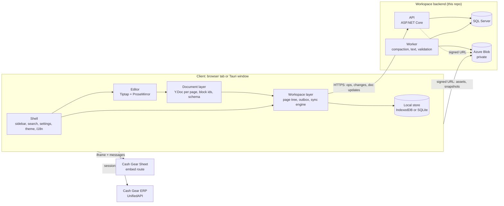
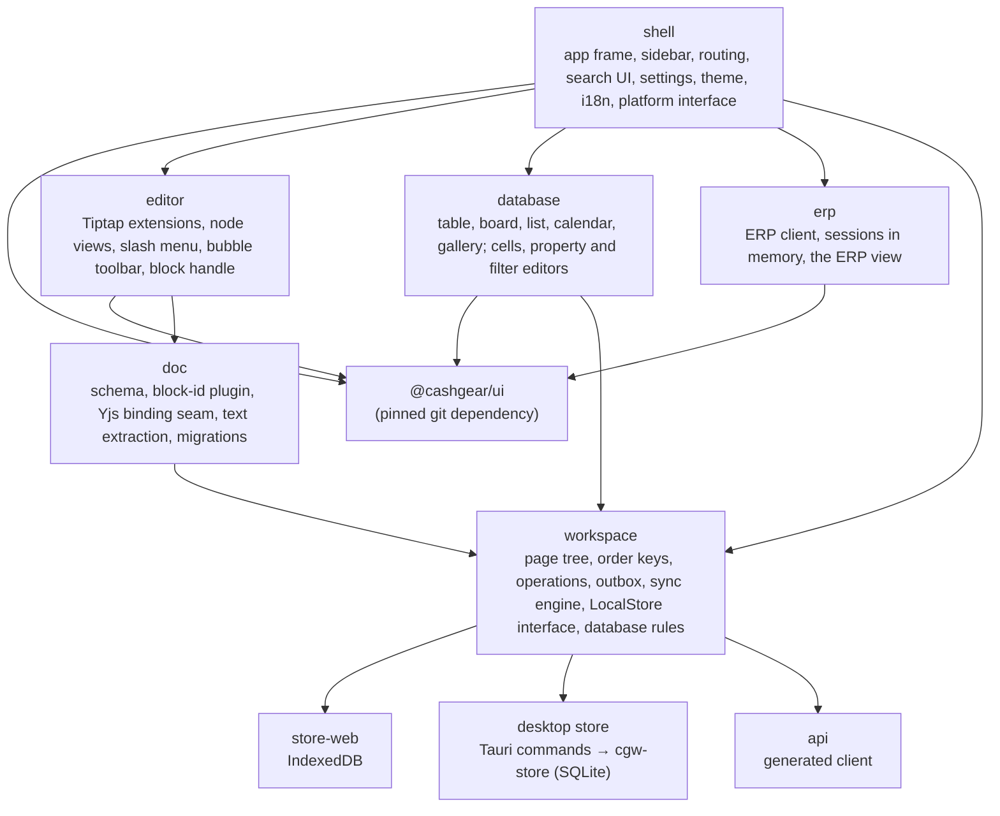
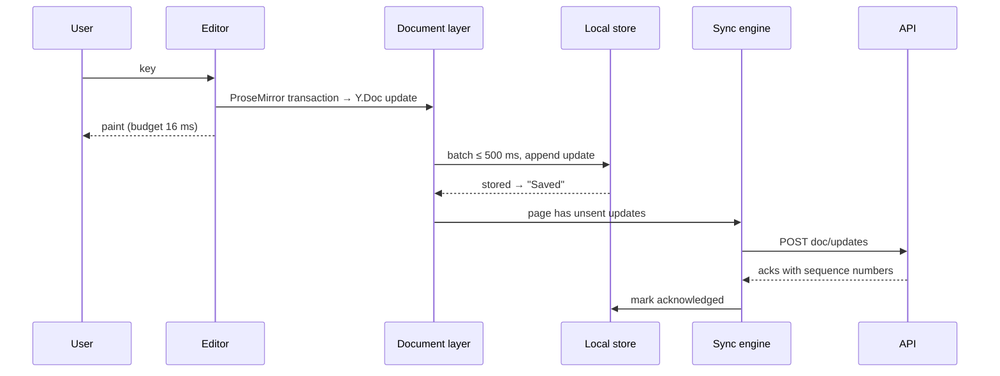

# Architecture

Cash Gear Workspace is a block-based workspace (documents, a page tree, databases, embedded
sheets and ERP data) that runs in a browser and as a Tauri desktop app, with a cloud backend and
offline editing.

This document says what the parts are and how data moves between them. Why each choice was made
is in `DECISIONS.md`. The stored shapes are in `DATA_MODEL.md`, sync in `SYNC_DESIGN.md`, and the
Sheet and ERP contracts in `INTEGRATIONS.md`.

Status: Phases 0 to 4 are built: the local-first editor and page tree (Phase 1); the server,
accounts, sync while online, sharing, server search and history (Phase 2); offline, conflicts,
migrations and the Mac app (Phase 3); workspace databases and their views (Phase 4); Sheet
workbooks embedded in pages and read-only ERP blocks (Phase 5). What exists
is listed in `CLAUDE.md`; later phases' parts are proposals. Spike results are in `DECISIONS.md`
(2026-11-11: Phase 0 results); each phase's answers and defaults under its own date. Deployment is
in `OPERATIONS.md`.

## What already exists in the Cash Gear ecosystem

Read from the repositories on 2026-11-11.

### Cash Gear Sheet (`D:\CashGear\Projects\cashgear-sheet`, v1.8.0)

| Area | What is there | Use for Workspace |
| --- | --- | --- |
| Tooling | pnpm 12 workspace, Cargo workspace, React 19.3, TypeScript 6, Vite 8, Tauri ~2.12, Vitest, Playwright, ESLint 10, Prettier 3 | Copy the root configs as the template |
| Licence gates | `deny.toml`, `license-policy.json`, `scripts/check-licenses.mjs` | Copy; same policy (no GPL, AGPL, LGPL, SSPL, BUSL) |
| CI and release | `.github/workflows/ci.yml`, `release.yml`, Azure Static Web Apps deploy, signed NSIS, updater feed on GitHub releases | Copy and rename |
| Tauri shell | `apps/desktop/src-tauri`: strict CSP, updater and dialog plugins, NSIS hooks, minimal capabilities | Copy the skeleton; Workspace's CSP differs (no COEP, `frame-src` for Sheet) |
| Platform split | `SheetPlatform` in `packages/ui/src/platform.ts`, implemented by `apps/web/src/platform/web.ts` and `desktop.ts`, chosen with `isTauri()` | Copy the pattern as `WorkspacePlatform` |
| Theme | `ThemeController` in `packages/ui/src/theme.ts`: system or manual, `data-cg-theme`, window title-bar theme | Copy and trim (no canvas palette) |
| Shortcuts | `packages/ui/src/shortcuts.ts`: Ctrl chords through `event.code`, so they work on an Arabic layout | Copy the mapping approach |
| Worker client | `packages/engine-client/src/client.ts`: Comlink, calls reject once disposed | Copy the pattern for the search and export workers |
| Updater UI | `release/useUpdates.ts`, `ReleaseDialogs.tsx`, `src/updates.rs` | Copy |
| ERP session | `packages/erp-connector`: HTTP client, session, launch ticket, validation of every response | Model for the ERP connector |
| Docs and workflow | `CLAUDE.md`, `docs/PLAN.md`, `docs/PROGRESS.md`, `docs/decisions.md`, phase tags | Same workflow here |
| Formula engine | Formualizer fork, MIT/Apache, behind `crates/cgs-calc` | Candidate for database formulas (Phase 4) |

Not there, so not assumed: an embeddable grid or app component; any iframe, `postMessage` or
embed mode; a read-only or preview mode; a range-to-image API; cloud workbook storage or
identity; user login; autosave (it has a crash-recovery journal instead); an i18n library or an
Arabic UI catalogue; a generic command registry. `AppShell.tsx` is one 3,140-line component.

### Shared UI (`D:\CashGear\Projects\CashGear.React.UI`, `@cashgear/ui` 0.1.0)

- The only React UI library. (`D:\CashGear\Projects\CashGearUI` is a legacy WinForms solution.)
- React 19 peer, no runtime dependencies, CSS Modules, `--cg-*` tokens, `data-cg-theme` for light
  and dark, `data-cg-density`, logical CSS, direction from the nearest `dir`, per-component
  `labels` props for translation, Storybook with Axe.
- Consumed as a git dependency pinned to a commit. Three apps pin three different commits.

| Workspace needs | In the library | Gap (Track U) |
| --- | --- | --- |
| Sidebar tree | `CgTreeView` | Drag-and-drop, lazy loading, virtualisation, inline rename |
| Resizable sidebar | `CgSplitter`, `CgDrawer` | None |
| Menus | `CgMenu`, `CgContextMenu` | None |
| Popovers | `CgFlyout` (anchors to a point or rectangle, flips, RTL-aware) | None; it is the base for the bubble toolbar |
| Slash menu, command palette | `CgListBox`, `CgSearchBox` | A command menu: filtered list, groups, keyboard, anchored to the caret |
| Bubble toolbar | `CgToolbar`, `CgButtonGroup` | A selection-anchored toolbar |
| Block handle, block drag | none | A drag handle and drop indicator |
| Dialogs, toasts | `CgPopup`, `CgMessageBox`, `CgToast`, confirmation provider | None |
| Tabs | `CgTabs` | None |
| Database table view | `CgGrid` | To be assessed in Phase 4 |
| Colours, icons | `CgColorPicker`, `CgIcon` (122 Fluent icons, mostly office) | Block-type and page icons; an emoji picker |
| Breadcrumb, avatar | none | Both |
| Rich text | `CgRichTextEditor` (Tiptap 3.31, sanitised HTML in and out) | Not usable as the block editor; confirms Tiptap is an accepted dependency |
| Ribbon | `CgRibbon` | Not used |

### Cash Gear ERP (`D:\CashGear\Projects\CashGear`)

- .NET 10, EF Core 10 and Dapper, SQL Server only. A database per tenant group plus a `Company`
  column in nearly every key. No EF migrations; schema changes are hand-run scripts. No local
  database.
- UnifiedAPI authenticates with long-lived API keys. For Sheet it has a ticket → session scheme
  with per-entity `Schema`, `Query` and `Commit` (see `INTEGRATIONS.md`).
- Azure Blob Storage is used through a connection string or account key. No signed URLs are
  generated anywhere. One container is public on purpose.
- UnifiedAPI has no rate limiting and an open CORS policy outside the Sheet routes. SignalR hub
  classes exist but none is mapped.
- Not inspected: production hosting, the live workflow configuration (it exists only in the
  database), and whether secrets in settings files are real.

What Workspace reuses from the ERP is the launch-ticket session pattern and its connector
contract. It does not share the ERP's identity store, database or deployment.

## Architecture options compared

| Option | Sketch | Verdict |
| --- | --- | --- |
| A. Local-first, CRDT documents, relational metadata, ASP.NET Core backend | Tiptap + Yjs in the client; SQL Server and Blob on the server; TypeScript sync engine over a local store | **Chosen** |
| B. Server-authoritative JSON documents | ProseMirror JSON saved by HTTP; the server is the truth | Simplest now. Offline on two devices can only be whole-page last-writer-wins, and real-time later means migrating every document and rewriting undo and sync |
| C. Everything in CRDTs, including the tree and databases | One sync mechanism | A CRDT cannot enforce "no cycles", permissions or uniqueness; moves in Yjs are delete and insert; server-side filtering of database rows would need to decode documents |
| D. Rust core compiled to WASM for the document model, as Sheet does for cells | One engine, native and web | Sheet draws to a canvas, so the engine can own the data. A rich-text editor is bound to the DOM, the IME and the selection; a WASM hop per keystroke costs, and every mature editor is TypeScript |
| E. Node collaboration server (Hocuspocus) | Ready-made Yjs server | Adds a Node service to a .NET estate that has none |

## System overview



Solid arrows inside the client are calls; the editor never talks to the network or to storage.

## The client

### Layers



Dependency rules, enforced by lint:

- `doc` and `workspace` import no React and no DOM. They run in a worker and in Node tests.
- `workspace` knows nothing about ProseMirror or Tiptap. It stores and moves opaque Yjs bytes.
  This is what keeps the page hierarchy independent of the editor.
- `editor` knows nothing about storage or the network. It is given a `Y.Doc` and callbacks.
- `database` (Phase 4) knows nothing about storage or the network either: it is given a
  `DatabaseHost` (records, a live row source per view, operations, people, assets), which the shell
  implements over the session, the local store and the sync engine. The editor knows nothing about
  databases: a `databaseView` block is a frame the shell mounts the views into
  (`EditorHost.databases`).
- `erp` (Phase 5) holds the ERP's answers in memory and React state only: lint keeps it off
  `localStorage`, `sessionStorage`, `indexedDB`, `caches`, the stores, `@cgw/workspace`,
  `@cgw/api` and the layers above it; it calls the ERP itself (`fetch`), with the reader's own
  session. The editor knows nothing about Sheet or the ERP: `sheetEmbed` and `erpView` blocks are
  frames the shell draws into (`EditorHost.workbooks`, `EditorHost.erp`); the sheet embed's
  contract and its iframe host (`SheetEmbed`, DOM and `postMessage` only) are in `@cgw/editor`.
- Only `shell` knows which platform it runs on, through the platform interface.

### Proposed repository layout

Package level only. Files inside are decided by the phase that creates them.

| Path | What | Phase |
| --- | --- | --- |
| `apps/web` | Vite + React app and PWA; picks the platform | 0 |
| `apps/desktop` | Tauri 2 shell | 0 |
| `packages/doc` (`@cgw/doc`) | Document schema, block ids, Yjs seam, migrations, text extraction | 1 |
| `packages/editor` (`@cgw/editor`) | The block editor | 1 |
| `packages/workspace` (`@cgw/workspace`) | Tree, operations, outbox, sync engine, `LocalStore` | 1 |
| `packages/store-web` (`@cgw/store-web`) | `LocalStore` on IndexedDB | 1 |
| `packages/shell` (`@cgw/shell`) | App frame and everything around the editor | 1 |
| `packages/api` (`@cgw/api`) | Client generated from the server's OpenAPI document | 2 |
| `packages/database` (`@cgw/database`) | Database views and cell editors, given a `DatabaseHost` | 4 |
| `packages/erp` (`@cgw/erp`) | ERP connector client and the ERP view | 5 (built) |
| `crates/cgw-store` | `LocalStore` on SQLite, with FTS5 | 1 |
| `crates/cgw-native` | Desktop helpers without Tauri: deep links read into routes, safe file names; the keychain in Phase 2 | 1 |
| `crates/cgw-ydoc` | Bytes-in, bytes-out Yjs functions over `yrs` | 0 (spike), 2 |
| `server/` | .NET solution: API, worker, domain, infrastructure, tests | 2 |
| `tests/e2e`, `tests/mocks` (Phase 5: Sheet and the ERP), `tests/contracts` (Phase 5: `erp-connect.1`), `bench/`, `scripts/`, `docs/` | As in Sheet | 0 |

### Responsibilities

| Component | Owns | Does not |
| --- | --- | --- |
| Shell | Window layout, sidebar, breadcrumbs, routing, search box and results, settings, profile, workspace switcher, theme, language, connection status | Touch document content |
| Editor | Typing, selection, formatting, slash menu, Markdown shortcuts, drag and drop, clipboard, node views, keyboard navigation | Save, load, or call the network |
| Document layer | The schema; block ids; binding ProseMirror to a `Y.Doc`; undo; plain-text and Markdown output; schema-version check and migrations | Know where bytes are stored |
| Workspace layer | The page tree and its rules on the client; operations and the outbox; the sync loop; opening and closing documents; asset upload queue | Know what is inside a document |
| Local store | Durable local data behind `LocalStore` | Decide anything |
| Platform | What differs between browser and desktop: window theme, file dialogs, deep links, updater, keychain, which `LocalStore` | Hold app logic |

### Platform interface

Modelled on `SheetPlatform`, with different members:

```ts
interface WorkspacePlatform {
  kind: 'web' | 'desktop';
  apiBase?: string;                         // the Workspace API's origin (Q5); absent: this device only
  auth?: AuthPlatform;                      // the API's cookie, or PKCE with the keychain (below)
  webBase?: string;                         // the web app's, for share links made on the desktop
  openStore(): Promise<LocalStore>;
  setWindowTheme(theme: Theme | null): Promise<void>;
  saveFile(suggestedName: string, bytes: Uint8Array, type: string): Promise<void>;   // export
  openExternal(url: string): Promise<void>;
  requestPersistence?(): Promise<boolean>;  // browser
  onDeepLink?(open: (hash: string) => void): () => void;                            // desktop
  updates?: PlatformUpdates;                                                         // desktop
  onCloseRequested?(flush: () => Promise<void>): () => void;
}

type AuthPlatform =
  | { kind: 'cookie' }                      // the browser: nothing here holds a credential
  | { kind: 'bearer'; signIn(language): Promise<boolean>; token(): Promise<string | null>; signOut(): Promise<void> };
```

As built (`packages/shell/src/platform.ts`). The shell's `cloud/` folder holds the connection to
the API: the typed client (`@cgw/api`) authenticated by the platform's `auth`, the sync engine
(`@cgw/workspace`) wired to the open session, and the account, sharing and history screens.

### The editor

- **Engine.** Tiptap 3 on ProseMirror, with `prosemirror-tables` for tables.
- **Schema.** A uniform block container (`DATA_MODEL.md`). Lists are blocks.
- **Node views.** Plain DOM for every MVP block: text bodies, code blocks, images, files,
  bookmarks, child pages and tables (Phase 1: each is small, and the editor needs no React
  renderer). The menus, toolbars and table controls drawn over the editor are React. Embeds
  (Phases 4 and 5) may use React node views; heavy ones mount when scrolled near and unmount when
  far. As built in Phase 4, the database block is a plain DOM frame: it mounts the host's React
  view within 800 px of the scrolling pane, unmounts it beyond 2,400 px, and mounts again only when
  its database, view, block id or editability changes, never per transaction. Phase 5 put the
  database, sheet embed and ERP view blocks on one such lazy frame (`nodeviews/frame.ts`): mounted
  again only when the key changes (database, workbook or link; block id; editability), and given
  other attribute changes in place.
- **Slash menu.** Typing `/` opens a command menu at the caret, filtered as the user types, in
  the interface language, with keywords in both languages.
- **Markdown shortcuts.** Input rules: `#`, `##`, `###`, `-`, `1.`, `[]`, `>`, ```` ``` ````, `---`,
  `**bold**`, `*italic*`, `` `code` ``, `~~strike~~`.
- **Bubble toolbar.** On a text selection: bold, italic, underline, strike, code, link, colour,
  turn into. On a block selection: turn into, duplicate, delete, colour.
- **Block handle.** Appears beside the hovered or focused block: drag to move, click for the
  block menu. Reachable by keyboard.
- **Conversion.** "Turn into" changes the body kind and keeps the id, the text, the marks that
  are valid in the target, and the children.
- **Clipboard.** Copy writes our own format (with fresh-id marking), HTML and plain text. Paste
  prefers our format, then HTML through the schema's parser, then Markdown, then plain text.
  Pasted blocks always get new ids.
- **Undo.** Yjs `UndoManager`, tracking only the local user's changes.
- **Keyboard.** Everything reachable without a mouse: arrows across blocks, Tab and Shift+Tab to
  indent, Alt+Shift+arrows to move a block, Esc to select the block, Ctrl+/ for the block menu.
  Ctrl chords map through `event.code`, as Sheet does, so they work on an Arabic layout.

### Commands

One small command registry in the shell: `{ id, label, icon, shortcut, when, run }`. The slash
menu, the bubble toolbar, the block menu, the search palette (Ctrl+K) and keyboard shortcuts all
read it. This is new; Sheet has typed engine commands but no generic registry to reuse.

### Search

| Where | Index | Covers |
| --- | --- | --- |
| Browser | In memory, built in a worker from the local mirror and cached page text | Titles of every page; text of pages this device holds |
| Desktop | FTS5 in the local SQLite store | The same, durable |
| Server (Phase 2) | SQL Server full-text over `PageDocDerived.SearchText` and titles | Everything the caller may read |

Online, results from the server and the local index are merged, local first. Text is normalised
the same way everywhere before indexing and querying (D25). Results are filtered by permission on
the server at query time, never by the client.

## The backend

One ASP.NET Core (.NET 10) solution in `server/`. Two processes.

| Process | Does | Never |
| --- | --- | --- |
| API | Authentication, authorisation, operations, change feed, document push and pull, asset tickets, search queries, sharing, version listing | Loads a Yjs library |
| Worker | Compaction, snapshots, validation of updates (on a loop of its own), each page's state hash, derived JSON and text, backlinks, asset reference counting and clean-up, retention (the change feed after 90 days, the trash after 60), exports | Serves requests |

Modules, each with its own folder, services and tests: Identity, Workspaces, Pages, Documents,
Assets, Search, Sharing, Sync, Audit, Databases (Phase 4), Workbooks and ErpLinks (Phase 5,
`Cgw.Core/Workbooks`), and later Realtime, Ai. The Databases module (`Cgw.Core/Databases`) holds the C# port of the database rules
(coercion, conversion, queries, formulas, rollups, CSV) held to the TypeScript by shared vectors,
the operations on databases, views and rows, and the query engine: a database's rows cached in
memory per database and rows version, evaluated by the ported `queryRows`, keyset paged.

Conventions:

- **API style.** REST under `/api/v1`. JSON in camelCase. Resource routes, not verbs.
- **Contracts.** The OpenAPI document is generated from the code and checked into the repo. The
  TypeScript client is generated from it. A change to it shows in review.
- **Errors.** RFC 9457 ProblemDetails with a stable `code` (for example `tree.cycle`,
  `doc.epochMismatch`, `version.conflict`) and a `correlationId`. Clients switch on `code`, never
  on text.
- **Concurrency.** `ETag` and `If-Match` on single-record writes; `baseVersion` in operations.
- **Paging.** Keyset, with an opaque cursor.
- **Results.** Services return a result type, not exceptions, for expected failures.
- **Data access.** EF Core with migrations. A global query filter applies the workspace scope;
  raw SQL is allowed only in named, tested queries (search, the closure table).
- **Tests.** Each module is tested against a real SQL Server in a container, not an in-memory
  provider.

### Tenancy

- The workspace is the tenant. Every tenant-owned row has `WorkspaceId`.
- A request's workspace comes from the route, and the caller's membership is checked before any
  handler runs. The EF Core filter then scopes every query.
- A test walks every entity type and fails if one with `WorkspaceId` lacks the filter.
- Blob names start with the workspace id, and a signed URL covers exactly one blob.

### Authentication

| Client | Flow | Credential at rest |
| --- | --- | --- |
| Web app | Sign in on the API's own pages; `Secure`, `HttpOnly`, `SameSite=Lax` cookie; antiforgery token on writes | Cookie only. Nothing in `localStorage` |
| Desktop app | Authorisation code with PKCE through the system browser, back to a loopback listener on a port the app picks (RFC 8252, 7.3). The API's page asks the signed-in person to confirm the desktop's sign-in ("as {email}?") and issues the code only on that form's POST, so a link cannot sign a desktop in silently. The native side (`crates/cgw-native`, `apps/desktop/src-tauri/src/auth.rs`) exchanges and refreshes the tokens; the API bases it may talk to are fixed at build time | Refresh token in the OS keychain (Windows Credential Manager; the login keychain on macOS), never in the webview; access token in memory |
| Sheet (opening a workbook) | One-time launch ticket → file session (`sheet-session.1`): the API's own routes under `/api/v1/sheet-sessions`, a CORS policy for Sheet's origins without credentials | In memory, in Sheet's tab |
| ERP blocks | One-time ticket from the ERP client (a pop-up's `postMessage`, or the desktop's deep link `cashgear-workspace://erp#…`) → an ERP session the browser holds (`erp-connect.1`); Workspace's server never calls the ERP | In memory, per link per tab |

Accounts are ASP.NET Core Identity. OpenIddict issues tokens. Sign-in is rate-limited and locks
out after repeated failures. Passkeys and external providers can be added through Identity later.

## Where data lives

| Store | Holds | Never |
| --- | --- | --- |
| SQL Server | Accounts, workspaces, members, sections, pages and the closure table, permissions, favourites, the Yjs update log, the snapshot index, derived JSON and search text, asset metadata, databases and rows, the change feed, applied operations, the audit log, ERP links | Binary assets; ERP data |
| Azure Blob (private) | Images, attachments, compaction and history snapshots, workbook versions, exports | One object per block; anything public |
| Browser storage (IndexedDB) | The metadata mirror, cached documents, the outbox, cached and queued assets, preferences | Credentials; ERP data |
| Desktop (SQLite file, asset files, keychain) | The same as the browser, plus the FTS5 index and pinned pages; the refresh token in the keychain | The refresh token in a file |
| Memory | Open `Y.Doc`s, ProseMirror state, presence, access tokens, ERP sessions and query results | Anything that must survive a restart |

## Data flow

### Typing a character



Paint does not wait for storage, and storage does not wait for the network.

### Opening a page

1. The shell asks the workspace layer for the page. The record comes from the local mirror at once.
2. The local store returns the snapshot and updates; the document layer builds the `Y.Doc`.
3. The document layer checks `schemaVersion`. Too new for this build: read-only view and a
   prompt to update.
4. The editor binds and paints.
5. In the background the sync engine pulls updates after the last sequence it holds and applies
   them; the editor updates in place.
6. A page this device does not hold: steps 2 to 4 wait for the pull, with a skeleton shown.

### Starting offline (Phase 3)

1. The web app's service worker serves the build's own files (never anything from another origin:
   the API, signed URLs); the desktop app's are in the bundle.
2. The local store opens and the mirror draws the tree; the account this device last signed in
   with comes from the store's prefs, so the app is signed in and says "Offline, N changes
   waiting".
3. Pages this device holds (opened before, or pinned) open from the store; any other says it is
   not on this device yet and opens by itself when the network returns.
4. The sync loop backs off; the network returning, focus, or a timer that fires late (the machine
   slept) runs a pass at once.

### Creating a page offline

1. The client makes a page id and an order key, applies `page.create` to the mirror and the
   outbox in one transaction, and creates an empty document locally.
2. The page appears in the sidebar and opens.
3. When the network returns, the outbox is pushed, then the document's updates.

### Inserting an image

1. The file is checked (type, size), stored in the local store, and shown from there.
2. With an account: the client asks the API for an upload ticket, gets a signed URL for one blob,
   uploads straight to Blob Storage, and confirms. The worker checks the content type against the
   bytes and, for images, records dimensions.
3. The block stores the asset id only.

## Autosave, version history, backup

- **Autosave.** Local, within a second, no network (`SYNC_DESIGN.md`).
- **Version history.** Full-state snapshots written by the worker; restore is a forward edit.
- **Backup.** SQL Server full, differential and log backups with point-in-time restore; Blob soft
  delete and versioning with a retention of at least 30 days. SQL and Blob can drift by minutes
  after a restore, so the worker has a reconcile job (every 6 hours): a row whose blob is missing
  is first restored from Blob soft delete; failing that, a snapshot row is dropped (the page falls
  back to the previous snapshot plus updates) and an asset is marked missing; a blob with no row
  and older than a day is deleted. Every "missing" blob is looked up again before anything
  changes.
- **Restore drill.** Restoring to a scratch environment and opening pages is an exit criterion of
  Phase 2, and is repeated each release.

## Security

| Concern | Design |
| --- | --- |
| Authentication | Own accounts; cookie for web, PKCE for desktop; lockout and rate limits on sign-in |
| Authorisation | Decided on the server for every request from membership, role and page permissions. The interface hiding a button is never the control |
| Tenant isolation | Workspace id from the route, membership check, query filter, test that every entity is filtered, blob paths under the workspace id |
| Workspace roles | Owner, admin, member, guest |
| Page sharing | Per page with inheritance; access lists by user or whole workspace; share links off by default, created by a person, hashed, expiring, revocable, view-only at first |
| No public URLs | Nothing is reachable without a session or a share link someone made. Blob containers are private |
| Attachments | Signed URL for one blob, about 5 minutes, issued after a permission check. Downloads are served with `Content-Disposition: attachment` and a safe content type; images are served only as images |
| Upload safety | Allow-list of types; size limit; type checked against the bytes; SVG is not rendered inline; a hook for malware scanning before `ready` |
| XSS | Content is drawn only through the ProseMirror schema, which whitelists nodes and attributes. No `innerHTML` from document data. Pasted HTML goes through the schema parser, so scripts, handlers and unknown attributes do not survive |
| Links | Scheme allow-list checked when parsed, when drawn and when clicked; external links open with `noopener noreferrer` |
| Embedded content | Sandboxed iframes from an allow-list of origins; bookmarks are static cards, with previews fetched by the server |
| Link previews | Server-side fetch behind an SSRF guard: public addresses only, no redirects to private ranges, size and time limits |
| Content Security Policy | `default-src 'self'`; `script-src 'self'` (plus `'wasm-unsafe-eval'` only if WASM is loaded); `frame-src` the one Sheet origin of the build (`VITE_CGW_SHEET`); `img-src 'self' blob: data:`; `connect-src` the API bases (`https://workspace-api.cashgearerp.com`, and `http://127.0.0.1:5280` for development), the blob host (`https://*.blob.core.windows.net`, Azurite in development) and the ERP's API (`VITE_CGW_ERP_API`, Phase 5). No COEP. On the web it is made from the build's API address (`apps/web/vite.config.ts`): `vite preview` sends it, so e2e runs under it, and the build writes it into `staticwebapp.config.json` with `nosniff`, a referrer policy and `frame-ancestors 'none'`; the desktop's is in `tauri.conf.json`. The API's own sign-in pages send a CSP of their own (no script at all; forms only to itself, the web app and the loopback listener) |
| Tauri | Minimal capabilities; typed commands only; no command takes SQL, a path outside the app's data directory, or a URL to fetch; `frame-src` as on the web. The macOS acceptance run drives the app through a test-only bridge (cargo feature `e2e-bridge`): `build.rs` refuses it in a release build and the release check fails a binary that holds it |
| Rate limiting | ASP.NET Core rate limiter: per IP on anonymous routes, per user and per workspace on the rest, tighter on sign-in, ticket redemption (`ticket`, per address), push and search; Sheet's session routes in a bucket of their own (`sheet`) |
| Audit | Append-only log of sign-ins, member and role changes, sharing changes, exports, restores, permanent deletions, ERP link changes, with a correlation id |
| Token storage | Web: cookie only. Desktop: OS keychain. ERP and file sessions: memory only. Tickets and sessions are stored hashed on the server |
| Secrets | Not in the repo and not in settings files. Environment or a secret store; managed identity for Blob where the host allows it. A check fails on a secret in the repository (`scripts/check-secrets.mjs`, first in `pnpm check` and in CI): private keys, storage keys and SAS signatures, tokens, the updater's key, connection-string passwords, key and environment files |
| Transport | HTTPS only, HSTS |
| Export and deletion | A workspace exports as a zip. Workspace and account deletion are described in `DATA_MODEL.md` |
| Backup and restore | Above |
| Dependencies | Licence gate and `cargo deny` in CI, as in Sheet; lockfiles committed |

## Performance

Targets, validated in Phase 0 and then gated in CI.

| Measure | Budget | How it is measured |
| --- | --- | --- |
| Cold start to an editable page, desktop | ≤ 1.5 s | Playwright against the built app, from process start to first editable paint |
| Cold start to an editable page, web, cached | ≤ 2 s | Lighthouse and a Playwright trace on a mid-range laptop profile |
| Open a 200-block page from the local store | ≤ 300 ms | From asking for the page to its blocks painted, in the app over a seeded store; p95 of 30 runs |
| Open a 2,000-block page | ≤ 1 s | Same, 15 runs |
| Editor work per keystroke, typical page (200 blocks), p95 | ≤ 8 ms (Q19) | From the keydown to the end of the work it causes, scripted typing in the app |
| Keystroke to the next frame, typical page (200 blocks), p95 | ≤ 33 ms (Q19: the 16 ms of Phase 0 was missed by 1 to 3 ms, and counts a frame the browser schedules) | From the keydown to the frame after the change is drawn |
| Keystroke to the next frame, 5,000 blocks, p95 | ≤ 50 ms | Same |
| Heap with a 5,000-block page open | ≤ 150 MB | The page's heap after a collection (`Runtime.getHeapUsage`), 10,000-page workspace loaded |
| Sidebar: expand a node in a 10,000-page workspace | ≤ 100 ms | Scripted, virtualised tree |
| Local search over 10,000 pages | ≤ 100 ms | Scripted queries in Arabic and English |
| Edit durable locally | ≤ 1 s after the last key | Kill test |
| Push round trip, one update | ≤ 200 ms at the server, p95 | Server timing under load |
| Initial JavaScript, gzip | ≤ 350 kB before the editor loads; the editor in its own chunk | Build report, gated |
| Database table: first rows of a 50,000-row database (Phase 4) | ≤ 500 ms | From opening the view to its first rows painted |
| Database table: scrolling 50,000 rows | 60 frames a second | Frame times while scrolling, virtualised rows |
| Database query on the server, 50,000 rows, one filter and one sort, p95 | ≤ 300 ms | Server timing, in process |
| Board drag | ≤ 16 ms a frame | Frame times while a card is dragged |
| Database cell edit | ≤ 16 ms to the next frame; durable ≤ 1 s | From the commit to the next frame; to the store |

How the budgets are met:

- **Rendering.** Plain DOM node views for common blocks; `content-visibility: auto` with a size
  hint on top-level blocks; heavy node views mounted lazily. Nothing is drawn per block on every
  change: the block handle is one floating element (spike S6 measured a widget per block at about
  95 ms a keystroke on a 5,000-block page). React state is kept out of the
  typing path: the editor is not re-rendered by React on each transaction.
- **Incremental updates.** Yjs updates are small differences; only those are stored and sent.
- **Large workspaces.** The sidebar draws from the metadata mirror with a virtualised tree; no
  document is loaded for it.
- **Multiple open documents.** At most a few `Y.Doc`s stay in memory; others are closed and
  reopened from the local store.
- **Background work.** Search indexing, export, and compaction of local documents run in workers.
- **Embeds.** A sheet embed loads its iframe only when near the viewport; before that it shows
  the stored picture (Phase 5: the budgets are in `bench/phase5.mjs`). A database view asks for a page of rows at a time and virtualises its own
  rows.
- **Startup.** The shell paints from the mirror before the editor chunk loads; the last page's
  document is read in parallel.
- **Parity.** The same build and the same budgets on Chrome and on WebView2; the desktop adds only
  the store and the shell.

Benchmarks live in `bench/`, use a generator that makes Arabic, English and mixed documents of a
given size and block mix, and write results the CI compares with the last run on `main`.
`bench/phase1.mjs` measures the budgets above that need no server, in the whole app over an
IndexedDB store seeded with a 10,000-page workspace (`bench/editor/app.html`), plus the desktop's
cold start and the kill tests' durability; a figure over its budget, or worse than the last run on
`main` by half again and by more than a small margin, fails the build.

## User interface

```
┌────────────┬────────────────────────────────────────────────────┐
│ Workspace ▾│  Section › Parent › Page            ⌕  ☆  ⋯  Saved │
│ ⌕ Search   ├────────────────────────────────────────────────────┤
│ Favourites │                                                    │
│  ☆ …       │   [cover]                                          │
│ Section    │   📄  Page title                                   │
│  ▸ Page    │                                                    │
│  ▾ Page    │   ⠿ Paragraph …                                    │
│     Page   │   ⠿ ▸ Toggle                                       │
│ Private    │   ⠿ ☐ Task                                         │
│  ▸ Page    │        ┌ B I U S <> 🔗 A ▾ Turn into ▾ ┐           │
│            │                                                    │
│ Trash      │                                                    │
│ ⚙ Settings │                                                    │
│ 👤 Profile │                                                    │
└────────────┴────────────────────────────────────────────────────┘
```

- **Left sidebar.** Collapsible and resizable (`CgSplitter`): workspace switcher, search,
  favourites, sections with nested pages, trash, settings, profile. On a narrow screen it becomes
  a drawer (`CgDrawer`).
- **Top bar.** Breadcrumbs, search, favourite, page menu (history, export, move, delete), save
  and connection status.
- **No ribbon.** A bubble toolbar on selection, a slash menu, and a block handle menu.
- **Themes.** Light and dark through `data-cg-theme` and the `--cg-*` tokens; follows the system
  or a manual choice. Text and highlight colours in documents are named tokens, so a document
  reads correctly in both.
- **Languages.** English and Arabic catalogues. Changing language changes `dir` on `<html>`.
- **RTL.** Logical CSS only. The sidebar, breadcrumbs, menus and the block handle mirror. Each
  text block takes its direction from its first strong character unless set, so a page mixes
  Arabic and English paragraphs. Lists, toggles and tables follow their content.
- **Keyboard first.** Every action has a command and a shortcut; Ctrl+K opens search and
  commands; focus order follows reading order in both directions.
- **Mobile browsers.** The layout is responsive and usable by touch: the drawer sidebar, a
  toolbar above the keyboard in place of the bubble toolbar, long-press for the block menu. Drag
  to reorder is replaced by "Move up" and "Move down" there. A native mobile app is not planned.
- **Accessibility.** WCAG 2.2 AA as the target: roles and names on every control, visible focus,
  contrast from the tokens, reduced motion respected, Axe run in CI on the main screens, and a
  screen-reader pass per phase.
- **High-DPI.** Vector icons, no bitmap chrome, images drawn at the device's pixel ratio.

## Risks and trade-offs

| Risk | Earliest phase | What is done about it |
| --- | --- | --- |
| The block-container schema fights ProseMirror or Yjs (caret, split, paste) | 0 | Spike S1 and S5 before any feature |
| Block ids churn or duplicate under Yjs | 0 | Own plugin; spike S1 with 10,000 random operations |
| A stale client damages documents | 0 | Schema-version gate; spike S2 |
| The in-house `yrs` library diverges from Yjs | 0 | Spike S3 against 1,000 fuzzed documents; YDotNet as fallback (S4) |
| Arabic IME, bidi caret or list markers misbehave in WebView2 | 0 | Spike S5 with a scripted checklist |
| Large pages miss the keystroke budget | 0 | Spike S6; the fallbacks are lighter node views and splitting pages |
| Yjs moves lose concurrent edits | 3 | A stated limit; tests; version history |
| Local browser storage is evicted | 1 | Persistent-storage request; export from the first milestone; say "on this device only" |
| Identity is security-critical code we host | 2 | ASP.NET Core Identity and OpenIddict, no custom crypto; rate limits; audit |
| SQL and Blob drift after a restore | 2 | Reconcile job; restore drill as an exit criterion |
| Sheet embed blocked by cross-origin isolation | 0 | Spike S9; the fallback is the stored picture plus "Open in Sheet" |
| Phase 5 waits on work in other repos | 5 | Mocks for both contracts; Track S starts during Phase 4 |
| The UI library needs many new components | 1 | Track U listed up front; built there, pinned here |
| Real-time needs more than one server node | 6 | Stateless hub; decided when measured |
| Scope: a Notion clone is large | every | Phases that each ship; a strict MVP; "Later" lists |

Trade-offs accepted, in one place:

- Two sync mechanisms (CRDT for content, operations for the rest) instead of one.
- A Rust library and a worker process on the server instead of a ready-made Node server.
- No ERP data offline, and no block-level permissions inside a page.
- A title that does not merge by character.
- Copied platform, theme and shortcut code instead of a shared package, for now.
